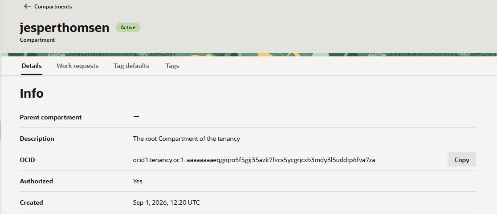
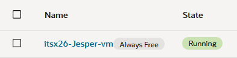

# Week 36 OCI Cloud Security Lab
## 1. Min OCI-miljö/Min lokala Linux-miljö/Min lokala WSL-miljö
- Tenancy (N/A): jesperthomsen
- Compartment (Endast OCI): jesperthomsen (root)
- Region (Endast OCI): eu-stockholm-1
- Availability Domain (Endast OCI): AD-1
- VM-namn/hostnamn/WSL-maskinnamn: itsx26-Jesper-vm
- Operativsystem: Canonical Ubuntu
- Shape (Hårdvara, gäller alla): VM.Standard.E2.1.Micro
- Inloggningsmetod: SSH med nyckel

Här är en screenshot på min compartment och vad som finns i jesperthomsen (root):

Här är en bild på att min VM är uppe och kör:

---
## 2. Linux-kommandon
| Kommando | Vad visar det? | CIA-koppling |
|-----------|-----------|-----------|
| whoami | inloggad som ubunu | (Konfidentialitet) Visar användaren som är inloggad och visar vem det är som skriver kommandot och visar hur enkelt det är att få tag på namnet på en användare.  |
| hostname | servern heter instance-20260901-1629 | (Konfidentialitet) Att detta kommando visar namnet på datorn eller namnet som tillgets i nätverket kan skapa problem som ingående attacker som kan se nätverket. |
| pwd | /home/ubuntu | (Konfidentialitet/ Riktighet) Då detta visar innehåll i mappen man kör kommandot kan detta skapa frågor kring riktigheten i mappen om det skulle vara så att andra har tillgång till din användar mapp och behöver ta extra steg för att försäkra sig att informationen är riktig. |
| uname -a |OS som körs är Linux instance-20260901-1629 7.0.0-1009-oracle #9-Ubuntu SMP PREEMPT Thu Jul 23 02:43:14 UTC 2026 x86_64 GNU/Linux | (Konfidentialitet) Då -a gör att du får en hel överblick om datorn eller nätverket kan detta visa sårbarheter så som versionsnummer, maskin name, samt på vilken OS den kör kan detta. |
| uptime | Servern har varit uppe i 19 timmar och 4 minuter, 09:47:01 up 19:04,  1 user,  load average: 0.11, 0.10, 0.09 | (Tillgänglighet) På uptime får man information hur många användare som finns på servern samt hur ansträngd servern är kan detta vara ett bra verktyg för att säkerställa att behöriga som behöver åtkomst kommer in och en översikt så servern inte blir överbelastat. |
---
## 3. Hardening
| Kontroll | Risk | Vad gjorde jag? | Hur verifierade jag? | CIA |
|-----------|-----------|-----------|-----------|-----------|
| | | | | |
---
## 4. Recovery-plan
### Vad kan gå fel?
### Hur upptäcker jag problemet?
### Vad kontrollerar jag först?
### Hur återställer jag åtkomst?
### När behöver jag hjälp?
---
## 5. Backup
### Vad har jag sparat?
### Vad finns i GitHub?
### Vad kan återskapas?
### Vad går inte att återskapa?
---
## 6. Cleanup
### VM-instans
### Diskar
### Backuper
### Publika IP-adresser
### GitHub-evidens
---
## 7. CIA-reflektion
### Konfidentialitet
### Integritet
### Tillgänglighet
---
## 8. Reflektion
### Vad fungerade bra?
### Vad var svårt?
### Vad lärde jag mig?
