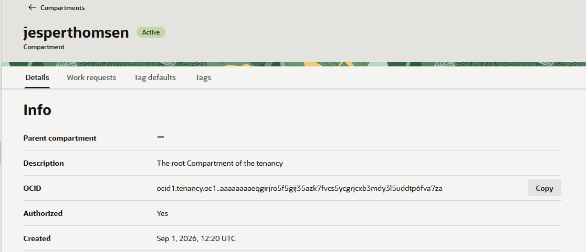
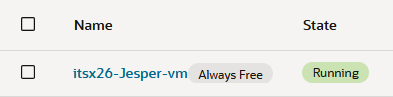
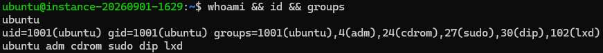
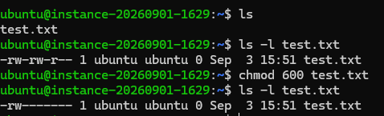
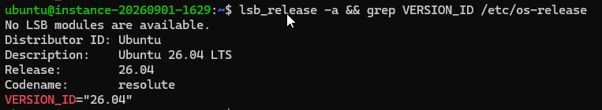
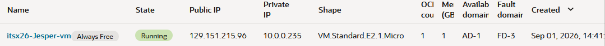
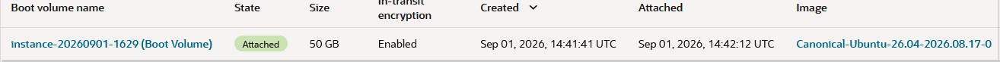
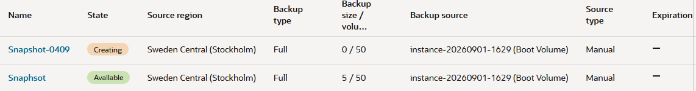
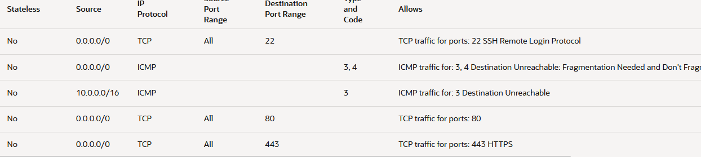

# Week 36 OCI Cloud Security Lab
## - [x] Delvis klar

## 1 & 2 Min OCI-miljö/Min lokala Linux-miljö/Min lokala WSL-miljö
- Tenancy (N/A): jesperthomsen
- Compartment (Endast OCI): jesperthomsen (root)
- Region (Endast OCI): eu-stockholm-1
- Availability Domain (Endast OCI): AD-1
- VM-namn/hostnamn/WSL-maskinnamn: itsx26-Jesper-vm
- Operativsystem: Canonical Ubuntu
- Shape (Hårdvara, gäller alla): VM.Standard.E2.1.Micro
- Inloggningsmetod: SSH med nyckel

Här är en screenshot på min compartment och vad som finns i jesperthomsen (root):

Här är en bild på att min VM är uppe och kör:

---
## 3.4 Linux-kommandon

| Kommando | Vad visar det? | CIA-koppling |
|-----------|-----------|-----------|
| whoami | inloggad som ubuntu | (Konfidentialitet) Visar användaren som är inloggad och visar vem det är som skriver kommandot. Detta visar hur enkelt det är att få tag på namnet på en användare och se dens rättigheter. |
| hostname | servern heter instance-20260901-1629 | (Konfidentialitet) Att detta kommando visar namnet på datorn eller namnet som tillgets i nätverket kan skapa problem som ingående attacker som kan se nätverket. |
| pwd | /home/ubuntu | (Konfidentialitet/ Riktighet) Då detta visar innehåll i mappen man kör kommandot kan detta skapa frågor kring riktigheten i mappen om det skulle vara så att andra har tillgång till din användar mapp och behöver då ta extra steg för att försäkra sig att informationen som du äger är riktig. |
| uname -a |OS som körs är Linux instance-20260901-1629 7.0.0-1009-oracle #9-Ubuntu SMP PREEMPT Thu Jul 23 02:43:14 UTC 2026 x86_64 GNU/Linux | (Konfidentialitet) Då -a gör att du får en hel överblick på datorn eller nätverket kan detta visa sårbarheter så som versionsnummer, maskin namn, samt på vilken OS den kör kan detta. |
| uptime | Servern har varit uppe i 19 timmar och 4 minuter, 09:47:01 up 19:04,  1 user,  load average: 0.11, 0.10, 0.09 | (Tillgänglighet) På uptime får man information hur många användare som finns på servern samt hur ansträngd servern är. Detta kan vara ett bra verktyg för att säkerställa att behöriga som behöver åtkomst kommer in och en översikt så servern inte blir överbelastat. |

## 4 Utforska Linux

| kommandon: | Vad kommandot gör | Vad resultatet betyder | Vilken del av CIA-triaden det kan kopplas till |
|-----------|-----------|-----------|-----------|
| ls -la | Skapar en lista på allt innehåll | Resultatet visar allt som finns i ett directory | (konfidentialitet / riktighet) Attackeraren får en helhetsbild på vad dem kan göra på din användare, vilka rättigheter på vilka filer som finns samt om det finns svagheter i systemet som kan exploiteras. |
| date | Fri Sep  4 14:32:08 UTC 2026 | Visar datum och tid | (riktighet) Hur jag resonerar runt riktighet är att om nätverket eller din VM är attackerad så kan attackeraren ändra loggar eller ändra datum och tid så informationen sparas fel. |
| id | Skriver användare & grupp info| Detta betyder att den som skriver in detta kan se vem användaren är samt vilken grupp användaren tillhör samt dess sekondära grupper. | (Konfidentialitet) Detta scenario är väldigt lik whoami där informationen som visar här kan skapa sårbarheter där attackeraren kan se ännu mer information som kan utnyttjas än whoami där information visar tillhörigheter både vart den huvudsakligen tillhör och har rättigheter men också andra grupper den har rättigheter som har tilldelats från andra håll. |
| groups | Visar vilken grupp användaren tillhör. | Visar endast primära grupper som användaren tillhör | (konfidentialitet) Även om detta är ett lindrigare kommando än id så visar denna kod återigen känslig information om tillhörande och rättigheter som användaren är anknyten till. |
| ps aux I head | Visar 10 processer | visar alla processer för alla användare, visar ägandeskap samt processer som ej är kopplade till terminalen. Head visar de 10 första högst krävande processerna. | (Konfidentialitet, tillgänglighet) ps aux visar alla processer oberoende på användare och kan visa känslig information kopplade till oilka användare och med rätt kommandon kan ett angrepp enkelt slå av viktiga processer som är aktiva i systemet. |

---
## 5. Hardening
| Kontroll | Risk | Vad gjorde jag? | Hur verifierade jag? | CIA |
|-----------|-----------|-----------|-----------|-----------|
| whoami && id && groups | Användare har sudo rättigheter vilket kan skapa problem om syntaxer eller kommandon är fel skrivna. | skapade en lista på vem som är användare, vilka rättigheter och grupper den tillhör. | Ubunutu är root och har sudo rättigheter genom id kommandot som visar rättigheter. | Konfidentialitet |
| chmod 600 | Kan låsa andra ute som behöver åtkomst till en specifik fil eller mapp | Skapade en fil och ändrade rättigheter | ls -la visar rättigheterna för filen | Tillgänglighet |
| sudo apt update | Risk för attacker utan regelbunden uppdatering | Uppdaterade min VM till senaste verionen | lsb_release -a && grep VERSION_ID /etc/os-release | Tillgänglighet, Konfidentialitet |
| SSH | Ogiltig nyckel | Återskapade VM via snapshot eller ange ny nyckel via Auth_Keys| Genom att kontrollera att min nyckel i Auth_keys stämmer överens med min publika nyckel lokalt | Tillgänglighet |

### Kontroll 1:

 

Ubuntu är användaren
Användaren tillhör adm, cdrom, sudo, dip & lxd
Administrativa rättigheter kan skapa stora problem om syntaxen eller kommandot är felskrivet

### Kontroll 2:

Vem får läsa filen?
Chmod 600 ändrar så bara ägaren får läsa filen.

Vem får ändra filen?
Endast ägaren.

### Kontroll 3:

Varför är uppdateringar viktiga?
Att uppdatera regelbundet skapar en säkrare miljö där mjukvara kan exploiteras
Vilken del av CIA påverkas?

Att uppdatera sin miljö regelbundet påverkar både användarens tillgänglighet då större uppdateringar kan ta längre tid och konfidentialiteten behålls säkert då uppdateringen kan minska risken för attacker. 

Hur verifierade jag? 
Jag körde "lsb_release -a && grep VERSION_ID /etc/os-release" som ger mig både all information om Ubuntu versionen jag kör samt dens specifika version

 

### Kontroll 4:

Hur loggade du in?
Jag loggade in med SSH till min OCI VM

Varför används SSH?
SSH är en säker metod för att få åtkomst till ett nätverk eller VM som en form av authentifiering. Jag ger min VM mitt pass, den kontrollerar så allt är OK och släpper igenom mig men om någon har ett pass som inte känns igen får dem inte åtkomst vilket skapar en säkrare miljö.

Vad skulle du göra om SSH slutade fungera?
Om min SSH skulle sluta att fungera behöver jag skapa antingen återskapa den från en tidigare snapshot eller undersöka /.ssh mappen om något har hänt med Authorized_keys filen. Om integriteten har kompromissats kan det vara att maskinen har blivit attackerad under natten. 

Om det skulle vara att det skulle vara problem med min nyckel kan jag enkelt lägga till min nya publika nyckel i Authorized_keys genom Vim och spara den nya nyckeln på en ny rad.

---

## 6. Recovery-plan

### Hur du upptäcker problemet

    Problemet kan upptäckas tidigt antingen via översikts menyn där man kan se aktivitet eller om du inte kan logga in till din VM via SSH

### Vad du kontrollerar först

    Jag kontrollerar först om min VM är på, Logga in med SSH och om detta inte fungerar går jag sedan till aktiviteter, eller kontrollerar min nyckel i Authorized_Keys för att stämma av att min nyckel är identisk.  

### Vilken information du behöver samla in

    * Kan jag logga in först och främst?
    * Om inte:
      * Kontroll att min SSH nyckel är identisk eller om den har blivit ändrad sedan sista sessionen.
      * Informationen jag behöver samla in är ls -la för att se att alla filer är kvar. 
      * Kollar "history" i konsollen
      * Kollar om "sar -u" har ytterligare information om aktivitet
      * Göra en enkel verifierings genom "whoami && id" för att se om mina rättigheter har ändrats. 
      

### Hur du skulle få hjälp

    Om jag skulle be om hjälp skulle jag fört gera min research om vad som behöver åtgärdas, sedan från en proffessionell om frågor som jag inte kan lösa själv. Om AI tas till hjälp dokumenteras detta.

### Hur du skulle kunna återskapa miljön

    Om VM:en ej går att rädda behöver jag återskapa den från en snapshot från tidigare datum eller tid där jag är säker att den inte var attackerad och säkerställer att mina harderning rutiner förbättras till nästa gång och loggar vad som hänt.

---

## 7. Backup

### Vad händer om VM:n försvinner?

    Om en snapshot inte tagits på en längre tid så förlorar man tyvärr allt som man har sparat eller gjort i sin VM från senaste sparade versionen. Alternativt om hela VM:et är helt borta behöver man tyvärr återskapa en ny VM från grunden.

### Vad finns i GitHub?

    Om man lyckas att spara sin snapshot eller filer direkt till Github och haft som vana att commit & pusha så bör allt ligga kvar. 

### Vad kan återskapas?

    Din senaste snapshot

### Vad går förlorat?

    Det du inte har laddat upp på Github eller från senaste snapshot

---

## 8. Cleanup

### VM-instans

    itsx26-Jesper-vm 

### Diskar

    instance-20260901-1629 (Boot Volume) 50GB

### Backuper

    Snapshot-0409
 

    Äldre snapshot från screenshot är borttagen

### Publika IP-adresser

    0.0.0.0:80
    0.0.0.0:443 

### GitHub-evidens

    Kopplade aldrig Github

### För OCI: Hur vet du att du inte har lämnat kvar resurser som kostar pengar?

    Man kan enkelt få en överblick om det du använder överskrider free-tier genom att lägga till funktionen "Cost Analysis" på den Home page.

---

## 7. CIA-reflektion

### Konfidentialitet

Konfidentialitet är en av de tre staplarna som bygger CIA triaden och har hjälpt mig skapa en uppfattning om vikten av säkerhet och hur många aspekter man behöver ha en förståele för. Även om alla aspekter av triaden har lika mycket vikt känner jag personligen att jag har lärt mig mest utav att jobba med konfidentialitet och hur man både reflekterar och argumenterar mot best practice och zero-trust.

### Integritet

Integritet tycker jag är väldigt intressant där man behöver tänka på hur, vad och när man behöver att gå den extra milen för att se till att all information är intakt och ante ändrat på ett sätt som anses som en attack.

Att integritet har en sådan vikt i triaden är en självklarhet och får en att tänka om på ett sätt som om man själv vore attackeraren

### Tillgänglighet

Jag tycker att tillgänglighet är ett intressant ämne som självklart har sin plats i triaden där otillgänglighet eller downtime kan skapa stora problem i den dagliga driften. Att den dagliga driften blir rubbad kan göra att företaget går i förlust och att göra att tillgängligheten en viktig del av triaden involverar inte bara downtimes, eller uppdatering av servrar men också användare om deras tillgänglighet till driften så som försvårad åtkomst, stora omvägar i omcertifieringen, ändring av lösenord eller krav på olika lösenord på olika ställen kan skapa mer problem än vad som gör nytta.

---

## 8. Reflektion

### Vad fungerade bra?

Att portalen på Oracle var smidig och strukturerad när man väl började förstå hur dem hade lagt upp det gjorde många moment inom cloud, SSh och hur man tänker kring säkerhet ett väldigt bra moment  

### Vad var svårt?

Att jobba i en cloud tjänst är helt nytt för mig och kändes som en djungel av menyer och inställningar som inte var särskilt användarvänligt. Även om jag trodde att jag var rätt var jag alltid i fel meny på något magiskt sätt. Detta i sin tur påverkade mina studier negativt.

### Vad lärde jag mig?

Det jag tar med mig från detta är hur man arbetar i cloud på basnivå men också ssh. Jag har lärt mig hur man säkert använder sig av säkerhetsnycklar, hur man genererar en nyckel samt hur man behöver tänka både som administratör för ditt nätverk men också som användare från utsidan som vill komma åt ditt nätverk eller maskin som är kopplat till nätet.