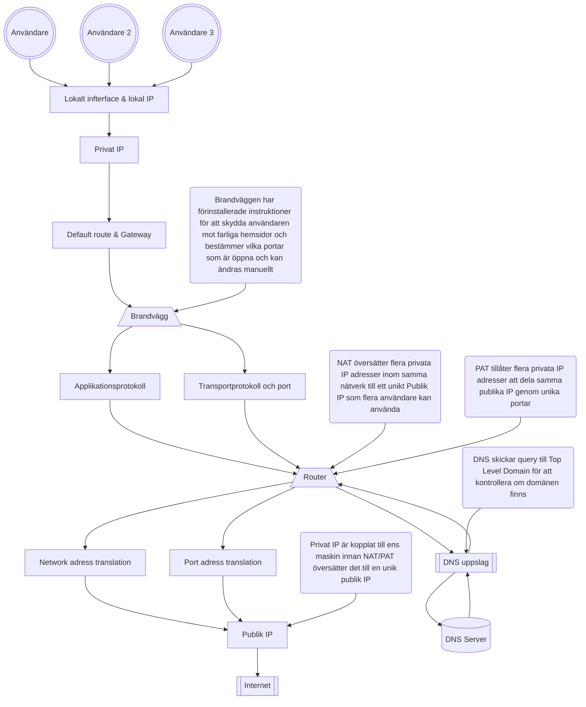
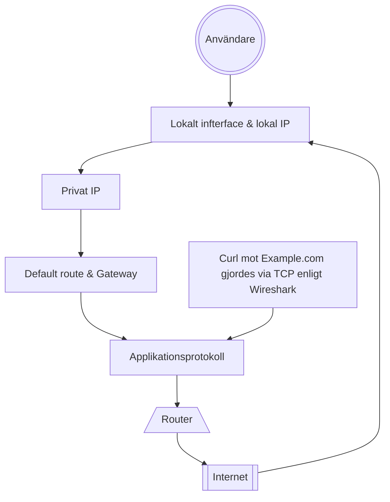

## SÄKERHETSRAMAR

### DU FÅR INTE

* Fånga andras trafik
* Portskanna eller använda brute force
* Publicera pcap
* Testa mål utanför godkänd miljö

### GÖR ISTÄLLET

* Använd egen miljö eller reservspår som trafikgenerator eller pcap filer som blev uppladdade "week38_packet_journey_basic.pcap" och "week38_packet_journey_advanced.pcap"
* Begränsa tid, interface och mål
* Sanera adresser och andra identifiers
* fråga läraren vid osäkerhet via Slack

Definition of Done

[X] Miljö, spår och metod är tydligt beskrivna.

[X] Fångsten är begränsad, tillåten och säker, eller reservspåret är motiverat.

[X] Paketets väg är beskriven med observation och förklaring åtskilda.

☐ DNS, ICMP, TCP, HTTP och TLS/HTTPS är analyserade eller saknad trafik är korrekt redovisad.

☐ Två flöden har analyserats på djupet.

☐ HTTP och TLS/HTTPS har jämförts.

☐ Brandvägg och hardening har kopplats till faktisk trafik.

☐ CIA-analysen bygger på konkreta observationer.

☐ Begränsningar och osäkerheter är synliga.

☐ Rapport och skärmbilder är sanerade.

☐ Rå pcap finns inte i GitHub utan uttryckligt tillstånd.

☐ AI-användning är redovisad.

☐ Canvas innehåller en fungerande direktlänk till rapporten.

| Område | Godkänt | Väl godkänt |
|---|---|---|
| Nätverksförståelse	| Förklarar grundläggande samband mellan adress, route, DNS, port och protokoll.	| Följer paketets väg konsekvent och skiljer observation från underbyggd teknisk förklaring. |
| Paketanalys	| Identifierar föreskrivna protokoll och visar relevant evidens.	| Analyserar flöden, ordning, metadata, avvikelser och alternativa förklaringar nyanserat. |
| Kryptering och säkerhet	 |Beskriver grundskillnaden mellan HTTP och TLS/HTTPS.	| Resonerar precist om synlig metadata, skyddad data, felsökningsvärde och konfidentialitetsrisk. |
| Brandvägg och hardening	| Kopplar trafik till regelprinciper och rimliga tjänster.	| Förklarar lager, tillstånd, default deny och minsta öppning med tydlig koppling till evidensen. |
| CIA och evidens	| Gör relevanta CIA-kopplingar och hanterar materialet säkert.	| Visar stark spårbarhet, identifierar begränsningar och formulerar proportionerliga rekommendationer. |
| Dokumentation	| Rapporten är begriplig, strukturerad och komplett.	| Rapporten är reproducerbar, analytisk och tydligt avgränsad. |

----------------------------------

## 01. Miljö och Metod

Miljö: OCI
Interface: Windows & OCI Ubuntu 26.04
Fångst: OCI tcpdump med SCP överföring, genom att använda -i any i tcpdump får man en bredare fångst där man inte behöver vara väldigt specifik i vad man letar efter, perfekt för troubleshooting.

Fångsten på OCI stoppas efter 1500 paket, jag stoppade manuellt tidigare med ctrl + c. Koden var för denna fångst:
    sudo tcpdump -i any -s 0 -c 1500 -w inluppg.pcap

Jag tog inspiration från trafikgeneratorn och lade upp dessa i rad efter varandra medans tcpdump var igång:

    ping 8.8.8.8 | head -11
    nslookup example.com
    ping 127.0.0.1 | head -11
    curl http://www.example.com/
    curl https://www.example.com/

I grund och botten har jag tagit inspiration från trafikgeneratorn men jag har lagt in en server som jag hostar på 8080 som jag pingar till som en extra del i min fångst.

### Beskriv hur pcap och skärmbilder har hanterats och sanerats.

pcap eller skärmbilder kommer läggas in i evidence/screenshots/w38. Jag kommer att redigera screenshots och bilder som tas under analys som en del av saneringen men inget har lagts till än.

Struktur på repot och vart du hittar bilderna är nämnt ovan samt märkt i strukturen nedan.

│

├── docs

│ └── week3_secure_network_check.md

│

├── evidence

│ └── screenshots

│   └── w38 <-- 

│

│ └── README.md

│

│

├── README.md

└── ...

strukturen tagen är från Canvas: Oracle Cloud VM, Linux, hardening, recovery och cleanup 

### Förklara relevanta skillnader mot lärarens OCI-demonstration.

Den stora skillnaden är att jag kallar på olika funktioner utanför ett skript för att simulera tid mellan samt för att skapa en djupare förståelse hur wireshark fungerar.
Jag överför då pcap filen från min OCI miljö till min primära dator där jag kan analysera paketen som jag både har tagit emot och skickat.

---------------------------------------

## 02. Paketets Väg

### Här nedan skapar jag ett flödesschema över min förståelse hur allt hänger ihop:

### Rita eller beskriv ett av flödena i din pcap från applikationen till destinationen.
* lokalt interface och lokal IP-adress
* DNS-uppslag
* default route och gateway
* privat respektive publik adress
* NAT/PAT som princip
* brandväggens möjliga beslutspunkt
* transportprotokoll och port
* applikationsprotokoll

Jag har valt ett flöde genom en curl mot HTTP example.com som jag tycker är väldigt intressant.

| Observation | Förklaring | Osäkerhet | Säkerhetsbetydelse / CIA |
|---|---|---|---|
|Curl till HTTP://www.example.com | Jag kan se att när jag skickade en curl mot addressen så svarar addressen och jag kan se information om hemsidan och dens uppbyggnad. Kort översikt: Ser 4 packet, En okrypterad HTTP request, Lyckad respons från servern, TCP sekvens och ACK nummer, tid mellan paketen, TTL + RTT samt att responsen från servern är genom text och HTML. | Då jag har inte jobbat i wireshark mycket har jag haft svårigheter att förstå eller analysera paket där information kan vara känslig, som visas i en sanerad screenshot från httpexample.png så har jag svårt att förstå om t.ex TSVAL eller TSecr håller någon särkild vikt inom sanering | Om man kollar utifrån ett säkerhetstänk så har jag sanerat denna fil samt strukit över information som IP addresser och vägen till destinationen. Detta kan både kopplas till integriteten där jag kollade om pcap filen blev ändrad under SCP överföringen genom att generera checksums för filen och kontrollerade hashen mot varandra och konfidentialitet där jag såg till att vissa portar var stängda och var inloggad via en SSH nycket. |

Här är en miniatyr av min förståelse av flödet:

### Fördjupning av protokoll
Identifiera flödet och ändpunkterna
Ordna relevanta paket i tidsföljd
Jämför protokoll, synlighet och resultat
Avgränsa vad fångsten kan visa
Vad skyddas av krypteringen?
Hur syns brandvägg och hardening indirekt?
Hur kopplas saniterad evidens till CIA?

* Konfidentialitet: Vad exponeras eller skyddas?
* Integritet: Vad kan ändras eller verifieras?
* Tillgänglighet: Når trafiken avsedd tjänst?
  
### CIA frågor
Konfidentialitet Vilken metadata är synlig? Vad är läsbart i HTTP? Vad skyddas av TLS? Kan pcap-filen i sig vara
känslig?
Integritet Hur vet du vilken fil som analyserats? Hur bidrar filnamn, hash, paketnummer och Git-historik till
spårbarhet?
Tillgänglighet Vilka tecken visar att DNS, route och transport fungerar? Vad kan timeout, reset eller uteblivet svar
betyda?

----------------------------------

* Evidensbeskrivning	evidence/README.md med pcap-källa, datum för analys, miljö och eventuell sanering

## Evidenskvalitet

Var samlades trafiken in?
Vilka filter eller avgränsningar användes?
Vad saknas/saknades vid fångsten?
Vilken osäkerhet ska anges? (förklara, var konkret)

### Vad ska jag anteckna
☐ Paketnummer eller annan tydlig hänvisning.
☐ Källa, destination och protokoll.
☐ Vilket lager eller vilken funktion observationen hör till.
☐ Vad observationen visar.
☐ Vad observationen inte räcker för att slå fast.
☐ Om uppgiften innehåller känslig metadata som behöver saneras

---------------------------------------
## 04. protokollinventering

Skapa en tabell med minst följande protokoll. Om ett protokoll saknas ska du beskriva hur du sökte och varför det rimligen kan saknas.

| Protokoll | Minsta evidens | Analysfråga | 
|---|---|---|
| DNS	| En query och motsvarande response, om tillgängligt |	Vilket namn efterfrågas, vilket svar ges och vad visar detta? |
| ICMP	| Ett echo request/reply-par eller dokumenterad frånvaro |	Vad visar trafiken om nåbarhet, och vilka slutsatser kan inte dras? |
| TCP	| En komplett eller delvis handshake |	Kan du identifiera SYN, SYN/ACK och ACK samt endpoints och portar? |
| HTTP	| En request och relevant response, om tillgängligt |	Vilka headers eller data är läsbara? |
| TLS/HTTPS	| ClientHello/ServerHello eller Application Data |	Vilken metadata syns och vad är krypterat? |

| DNS	| En query och motsvarande response, om tillgängligt |	Vilket namn efterfrågas, vilket svar ges och vad visar detta? |
|---|---|---|
| DNS	| Standard query, Message is a query | Example.com, svaret är Message is a response. Detta visar på att domänen finns och att den svarar paketet |

| ICMP	| Ett echo request/reply-par eller dokumenterad frånvaro |	Vad visar trafiken om nåbarhet, och vilka slutsatser kan inte dras? |
|---|---|---|
| ICMP	| Ping request till 8.8.8.8 och tillbaka OCI |	Jag skapade 10 pings mot servern och fick ett genomsnitt en respons på 8ms som visar på bra uppkoppling, Jag kan se att paket skickas, men kan inte se hur många gånger ett paket har hoppat eller dess RTT som man kan se hos TCP |

| TCP	| En komplett eller delvis handshake |	Kan du identifiera SYN, SYN/ACK och ACK samt endpoints och portar? |
|---|---|---|
| TCP	| Genom att filtrera med tcp.flags.syn==1 kan jag se att jag har skapat en 3 way handshake. Detta kan jag se genom att SYN och SYN + ACK finns. | Enligt IP som jag kontrollerar så är min OCI SYN och SYN ACK är en HTTP address. RTT till ACK var 2,4ms. Det ser också ut som att source port är 46378 och om jag öppnar paketet så ser det ut som att port 80 används, detta kan då vara handshake till och från Example.com.|

| HTTP	| En request och relevant response, om tillgängligt |	Vilka headers eller data är läsbara? |
|---|---|---|
| HTTP	| Curl mot Example.com, Response: OK | Då allt är okrypterat kan jag se hela uppbygnaden i html kod i head. Jag kan se att jag får denna informationen genom curl, datum och tid detta gjordes, server som hostar example.com samt vilket http protokoll som används vilket är HTTP1.1 |

| TLS/HTTPS	| ClientHello/ServerHello eller Application Data |	Vilken metadata syns och vad är krypterat? |
|---|---|---|
| TLS/HTTPS	| Klienten(jag) säger hello och Example.com ger en handshake och säger hello tillbaka |	Det ända jag kan se som är metadata är destinationen Example.com, att det är under application data protocol; HPT och resten av paketet är krypterat. |

---------------------------------------

## 05. Fördjupad analys av två flöden

Välj två olika flöden, varav minst ett ska vara TCP-baserat. För varje flöde ska du redovisa:

Flöde 1: TCP
* paketnummer eller tydlig flödeshänvisning: 1336, börjar med SYN från Linux
* källa, destination, port och protokoll: 02:00:17:01:c5:db, 104.20.23.154, Dst port 443, TCP
* händelseordning: OCI skickar förfrågan till Example.com, får svar tillbaka genom handshake med SYN ACK, klient(jag) skickar ett hello, får tillbaka ett hello och sedan skickas application data och krypterade paket mellan varandra och Example.com avslutar kontakten med ACK.
* förväntat beteende: Beteendet som var förväntat var att kopplingen skulle gå igenom då detta var en kontrollerad uppkoppling genom ett kommando men saker kunde alltid ha hänt som till exempel packet loss men inget jag hittade som var fel i handlingen i wireshark.
* faktisk observation: Observationen visar att kopplingen lyckades och fick en 3 way handshake med Example.com.
* eventuell avvikelse, timeout, reset eller retransmission: Uppkopplingen skapades utan problem och enligt RTT genom ACK så var kopplingen utan delay eller packet loss.
* alternativa förklaringar: Inget extra som jag kan se som avviker från observationen.
* vad mer som skulle behövas för en säkrare slutsats: Då jag inte är väldigt insatt i wireshark än så möter jag svårigheter att läsa och tyda vad som sker vid vissa tillfällen under konversationer mellan klient och destinationen.

Flöde 2: PING
* paketnummer eller tydlig flödeshänvisning: 290 Echo request
* källa, destination, port och protokoll: 02:00:17:01:c5:db, 8.8.8.8, ICMP kör inte igenom några portar.
* händelseordning: Klient skickar en echo ping request och väntar på att paketet kommer tillbaka medans klienten tar tid
* förväntat beteende: Förväntade mig snabbt svar från Google
* faktisk observation: Då jag skickade 10 packet och fick svar efter 7-9 millisekunder efteråt visar det på att kopplingen är stabil och fungerar utan förlorade paket.
* eventuell avvikelse, timeout, reset eller retransmission: UA
* alternativa förklaringar: Genom att skicka paket till olika servrar eller leverantörer kan man både felsöka på sin sida men också kontrollera om en viss hemsida är nere.
* vad mer som skulle behövas för en säkrare slutsats: För att kunna få en säkrare slutsat om hur echo ping requests fungerar skulle jag vilka veta mer om källan som stod som fråga i fördjupningen.

---------------------------------------

## 06. Krypterat och okrypterat

Jämför ett HTTP-flöde med ett TLS/HTTPS-flöde, eller använd motsvarande godkända exempel i reserv-pcapen.

| Aspekt | HTTP | TLS/HTTPS | 
|---|---|---|
| Synlig metadata	| Visar okrypterad information som datum, protokoller, servern som hostar hemsidan. | Hela paketet är krypterat och kan endast se hemsidan som det gäller. |
| Läsbar applikationsdata	| hela hemsidans innehåll i HTML kod som visar strukturen samt vilken request som gjordes mot hemsidan. | Kan inte se någon information om jag gör en follow option på ett HTTPS protokoll. |
| Felsökningsvärde	| Kan se vilken request klienten gjorde samt se vem som skickade requesten och till destinationen, analysera status koder som 200. | Det jag kan se är ip addresser, vilken hemsida som tar emot förfrågan genom follow funktionen samt vilken port paketet var på väg mot samt handshakes. |
| Konfidentialitetsrisk	| Det jag tänker spontant är att man kan se hemsidans uppbyggnad, vilket skapar möjlighet att återskapa hemsidan som t.ex phishing. Jag har läst om att hemsidor som kör med HTTP är känsligare mot injektioner genom olika program	| klientens IP, Destinations IP, port, längd av paketet, tid och datum samt vilken miljö som klienten skickade förfrågan från.|

---------------------------------------

## 07. Brandvägg och hardening

* Välj ett observerat flöde och ange vilken inkommande eller utgående brandväggsregel som principiellt skulle beröra det.
* Förklara skillnaden mellan en tjänst som lyssnar lokalt och trafik som tillåts passera en brandvägg.
* Resonera om default deny och minsta nödvändiga öppning.
* Koppla analysen till föregående veckors hardening: är de observerade tjänsterna och flödena rimliga för miljön?
* Du ska inte ändra brandväggsregler för att slutföra denna del.

---------------------------------------

## 08. CIA och evidens
| Område | Besvara |
|---|---|
| Konfidentialitet	| Vilken information i pcapen eller rapporten behöver skyddas? Vad visar jämförelsen HTTP och TLS? |
| Integritet	| Hur visar du att analysen hör till rätt pcap? Hur använder du filnamn, paketnummer, eventuell hash och Git-historik? |
| Tillgänglighet	| Vilka observationer visar att namnuppslag, route och transport fungerar eller inte fungerar? |
| Evidenskvalitet	| Vilka begränsningar finns i fångsten? Vad kan ha missats på grund av interface, timing, kryptering eller miljö? |

---------------------------------------

## 09. slutsats och rekommendation

Skriv en sammanhängande slutsats som besvarar:
    • Vad hände i den analyserade trafiken?
    • Vilka observationer är starkast underbyggda?
    • Vilka osäkerheter återstår?
    • Vilken säkerhets- eller driftåtgärd rekommenderar du, utan att överdriva vad pcapen visar?
    • Vilken ytterligare evidens skulle du samla in i nästa steg?

---------------------------------------

## 10. AI-användning

Om du använder generativ AI ska du redovisa verktyg, syfte, vilka förslag du använde eller avvisade, hur du kontrollerade analysen mot pcap-filen och vilka slutsatser du formulerade själv. Paketnummer, filterresultat och tekniska slutsatser måste verifieras av dig.

---------------------------------------

## Fördjupa flöden

Kan verifiera och jämföra vissa protokoller mot varandra för att se skillnad:

DNS <-> ICMP
HTTP <-> TLS/HTTPS
Lyckad anslutning <-> Uteblivet svar
egen pcap med reservspår genom trafigeneratorn

----------------------------------

## Brandvägg info

* SS bevisar lokalt lyssande tjänster men inte ensam extern nåbarhet
* Brandväggsregler beskriver avsedd tillåtelse eller blockering
* PCAP visar observerad nätverkstrafik vid fångspunkt

----------------------------------
