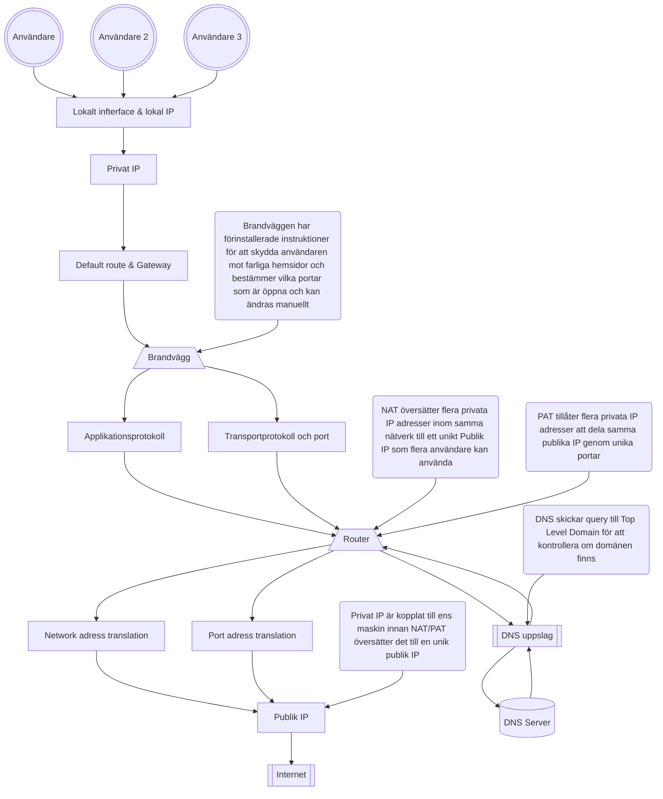
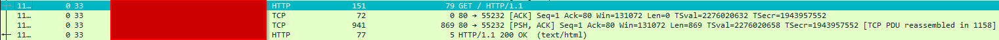
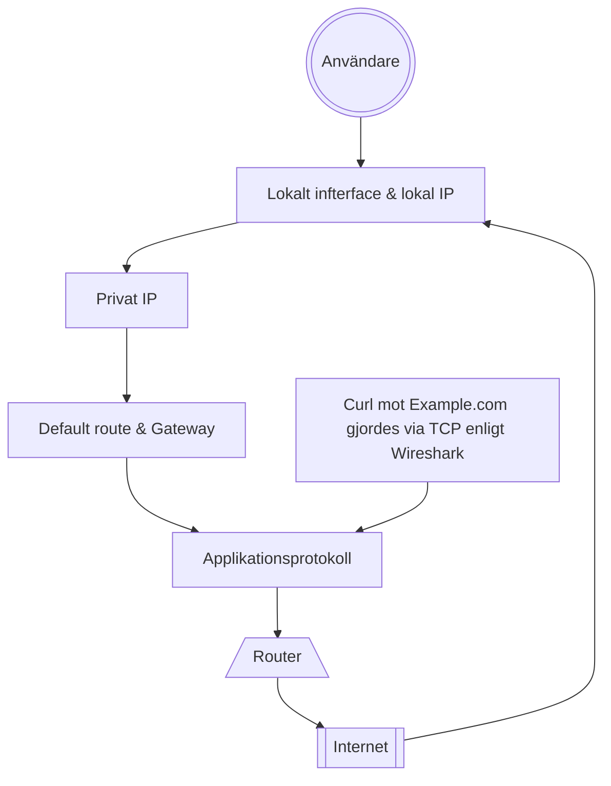
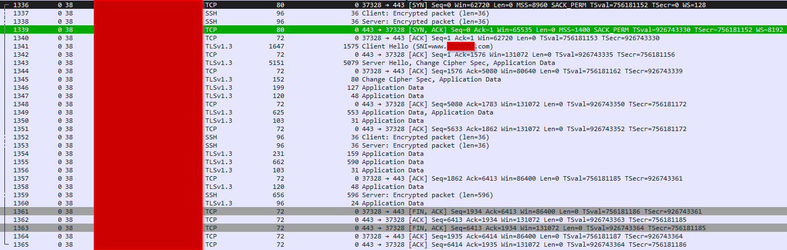
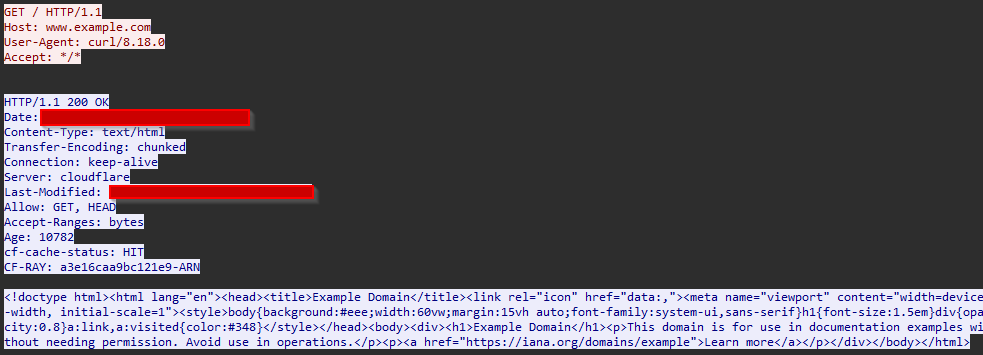
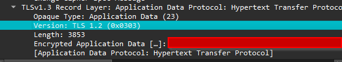

## SÄKERHETSRAMAR
----------------------------------
### DU FÅR INTE

* Fånga andras trafik
* Portskanna eller använda brute force
* Publicera pcap
* Testa mål utanför godkänd miljö

### GÖR ISTÄLLET

* Använd egen miljö eller reservspår som trafikgenerator eller pcap filer som blev uppladdade "week38_packet_journey_basic.pcap" och "week38_packet_journey_advanced.pcap"
* Begränsa tid, interface och mål
* Sanera adresser och andra identifiers
* fråga läraren vid osäkerhet via Slack

### Definition of Done
----------------------------------

[X] Miljö, spår och metod är tydligt beskrivna.

[X] Fångsten är begränsad, tillåten och säker, eller reservspåret är motiverat.

[X] Paketets väg är beskriven med observation och förklaring åtskilda.

☐ DNS, ICMP, TCP, HTTP och TLS/HTTPS är analyserade eller saknad trafik är korrekt redovisad.

☐ Två flöden har analyserats på djupet.

☐ HTTP och TLS/HTTPS har jämförts.

☐ Brandvägg och hardening har kopplats till faktisk trafik.

☐ CIA-analysen bygger på konkreta observationer.

☐ Begränsningar och osäkerheter är synliga.

☐ Rapport och skärmbilder är sanerade.

☐ Rå pcap finns inte i GitHub utan uttryckligt tillstånd.

☐ AI-användning är redovisad.

☐ Canvas innehåller en fungerande direktlänk till rapporten.

| Område | Godkänt | Väl godkänt |
|---|---|---|
| Nätverksförståelse	| Förklarar grundläggande samband mellan adress, route, DNS, port och protokoll.	| Följer paketets väg konsekvent och skiljer observation från underbyggd teknisk förklaring. |
| Paketanalys	| Identifierar föreskrivna protokoll och visar relevant evidens.	| Analyserar flöden, ordning, metadata, avvikelser och alternativa förklaringar nyanserat. |
| Kryptering och säkerhet	 |Beskriver grundskillnaden mellan HTTP och TLS/HTTPS.	| Resonerar precist om synlig metadata, skyddad data, felsökningsvärde och konfidentialitetsrisk. |
| Brandvägg och hardening	| Kopplar trafik till regelprinciper och rimliga tjänster.	| Förklarar lager, tillstånd, default deny och minsta öppning med tydlig koppling till evidensen. |
| CIA och evidens	| Gör relevanta CIA-kopplingar och hanterar materialet säkert.	| Visar stark spårbarhet, identifierar begränsningar och formulerar proportionerliga rekommendationer. |
| Dokumentation	| Rapporten är begriplig, strukturerad och komplett.	| Rapporten är reproducerbar, analytisk och tydligt avgränsad. |

## 01. Miljö och Metod
----------------------------------

Miljö: OCI
Interface: Windows & OCI Ubuntu 26.04
Fångst: OCI tcpdump med SCP överföring, genom att använda -i any i tcpdump får man en bredare fångst där man inte behöver vara väldigt specifik i vad man letar efter, perfekt för troubleshooting.

Fångsten på OCI stoppas efter 1500 paket, jag stoppade manuellt tidigare med ctrl + c. Koden var för denna fångst:
    sudo tcpdump -i any -s 0 -c 1500 -w inluppg.pcap

Jag tog inspiration från trafikgeneratorn och lade upp dessa i rad efter varandra medans tcpdump var igång:

    ping 8.8.8.8 | head -11
    nslookup example.com
    ping 127.0.0.1 | head -11
    curl http://www.example.com/
    curl https://www.example.com/

I grund och botten har jag tagit inspiration från trafikgeneratorn men jag har lagt in en server som jag hostar på 8080 som jag pingar till som en extra del i min fångst.

### Beskriv hur pcap och skärmbilder har hanterats och sanerats.
---------------------------------------

pcap eller skärmbilder kommer läggas in i evidence/screenshots/w38. 
Jag kommer att redigera screenshots och bilder som tas under analys som en del av saneringen men inget har lagts till än.

Struktur på repot och vart du hittar bilderna är nämnt ovan samt märkt i strukturen nedan.

│

├── docs

│ └── week3_secure_network_check.md

│

├── evidence

│ └── screenshots

│   └── w38 <-- 

│

│ └── README.md

│

│

├── README.md

└── ...

strukturen tagen är från Canvas: Oracle Cloud VM, Linux, hardening, recovery och cleanup.

### Förklara relevanta skillnader mot lärarens OCI-demonstration.

Den stora skillnaden är att jag kallar på olika funktioner utanför ett skript för att simulera tid mellan samt för att skapa en djupare förståelse hur wireshark fungerar.
Jag överför då pcap filen från min OCI miljö till min primära dator där jag kan analysera paketen som jag både har tagit emot och skickat.

## 02. Paketets Väg
----------------------------------

### Här nedan skapar jag ett flödesschema över min förståelse hur allt hänger ihop:

Jag har använt mig av Mermaid extension och använt mig utav deras gui för att se till att allt är på sin plats. [^2]

### Rita eller beskriv ett av flödena i din pcap från applikationen till destinationen.
----------------------------------

* lokalt interface och lokal IP-adress
* DNS-uppslag
* default route och gateway
* privat respektive publik adress
* NAT/PAT som princip
* brandväggens möjliga beslutspunkt
* transportprotokoll och port
* applikationsprotokoll

Jag har valt ett flöde genom en curl mot HTTP example.com som jag tycker är väldigt intressant.

| Observation | Förklaring | Osäkerhet | Säkerhetsbetydelse / CIA |
|---|---|---|---|
|Curl till HTTP://www.example.com | Jag kan se att när jag skickade en curl mot addressen så svarar addressen och jag kan se information om hemsidan och dens uppbyggnad. Kort översikt: Ser 4 packet, En okrypterad HTTP request, Lyckad respons från servern, TCP sekvens och ACK nummer, tid mellan paketen, TTL + RTT samt att responsen från servern är genom text och HTML. | Då jag har inte jobbat i wireshark mycket har jag haft svårigheter att förstå eller analysera paket där information kan vara känslig, som visas i en sanerad screenshot från httpexample.png så har jag svårt att förstå om t.ex TSVAL eller TSecr håller någon särkild vikt inom sanering | Om man kollar utifrån ett säkerhetstänk så har jag sanerat denna fil samt strukit över information som IP addresser och vägen till destinationen. Detta kan både kopplas till integriteten där jag kollade om pcap filen blev ändrad under SCP överföringen genom att generera checksums för filen och kontrollerade hashen mot varandra och konfidentialitet där jag såg till att vissa portar var stängda och var inloggad via en SSH nycket. |
Länk där jag lärde mig om checksums [^1]

Här är en bild på hur paketets struktur ser ut i Wireshark: 

Här är en miniatyr av min förståelse av flödet:

## 04. protokollinventering
---------------------------------------

Skapa en tabell med minst följande protokoll. Om ett protokoll saknas ska du beskriva hur du sökte och varför det rimligen kan saknas.

| Protokoll | Minsta evidens | Analysfråga | 
|---|---|---|
| DNS	| En query och motsvarande response, om tillgängligt |	Vilket namn efterfrågas, vilket svar ges och vad visar detta? |
| ICMP	| Ett echo request/reply-par eller dokumenterad frånvaro |	Vad visar trafiken om nåbarhet, och vilka slutsatser kan inte dras? |
| TCP	| En komplett eller delvis handshake |	Kan du identifiera SYN, SYN/ACK och ACK samt endpoints och portar? |
| HTTP	| En request och relevant response, om tillgängligt |	Vilka headers eller data är läsbara? |
| TLS/HTTPS	| ClientHello/ServerHello eller Application Data |	Vilken metadata syns och vad är krypterat? |

| DNS	| En query och motsvarande response, om tillgängligt |	Vilket namn efterfrågas, vilket svar ges och vad visar detta? |
|---|---|---|
| DNS	| Standard query, Message is a query | Example.com, svaret är Message is a response. Detta visar på att domänen finns och att den svarar paketet |

| ICMP	| Ett echo request/reply-par eller dokumenterad frånvaro |	Vad visar trafiken om nåbarhet, och vilka slutsatser kan inte dras? |
|---|---|---|
| ICMP	| Ping request till 8.8.8.8 och tillbaka OCI |	Jag skapade 10 pings mot servern och fick ett genomsnitt en respons på 8ms som visar på bra uppkoppling, Jag kan se att paket skickas, men kan inte se hur många gånger ett paket har hoppat eller dess RTT som man kan se hos TCP |

| TCP	| En komplett eller delvis handshake |	Kan du identifiera SYN, SYN/ACK och ACK samt endpoints och portar? |
|---|---|---|
| TCP	| Genom att filtrera med tcp.flags.syn==1 kan jag se att jag har skapat en 3 way handshake. Detta kan jag se genom att SYN och SYN + ACK finns. | Enligt IP som jag kontrollerar så är min OCI SYN och SYN ACK är en HTTP address. RTT till ACK var 2,4ms. Det ser också ut som att source port är 46378 och om jag öppnar paketet så ser det ut som att port 80 används, detta kan då vara handshake till och från Example.com.|

| HTTP	| En request och relevant response, om tillgängligt |	Vilka headers eller data är läsbara? |
|---|---|---|
| HTTP	| Curl mot Example.com, Response: OK | Då allt är okrypterat kan jag se hela uppbygnaden i html kod i head. Jag kan se att jag får denna informationen genom curl, datum och tid detta gjordes, server som hostar example.com samt vilket http protokoll som används vilket är HTTP1.1 |

| TLS/HTTPS	| ClientHello/ServerHello eller Application Data |	Vilken metadata syns och vad är krypterat? |
|---|---|---|
| TLS/HTTPS	| Klienten(jag) säger hello och Example.com ger en handshake och säger hello tillbaka |	Det ända jag kan se som är metadata är destinationen Example.com,  att det är under application data protocol; HPT och resten av paketet är krypterat. |
Information om Metadata[^5]

## 05. Fördjupad analys av två flöden
---------------------------------------

Välj två olika flöden, varav minst ett ska vara TCP-baserat. För varje flöde ska du redovisa:

Flöde 1: TCP
* paketnummer eller tydlig flödeshänvisning: 1336, börjar med SYN från Linux
* källa, destination, port och protokoll: 10.0.0.191, 104.20.23.154, Dst port 443, TCP
* händelseordning: OCI skickar förfrågan till Example.com, får svar tillbaka genom handshake med SYN ACK, klient(jag) skickar ett hello, får tillbaka ett hello och sedan skickas application data och krypterade paket mellan varandra och Example.com avslutar kontakten med ACK.
* förväntat beteende: Beteendet som var förväntat var att kopplingen skulle gå igenom då detta var en kontrollerad uppkoppling genom ett kommando men saker kunde alltid ha hänt som till exempel packet loss men inget jag hittade som var fel i handlingen i wireshark.
* faktisk observation: Observationen visar att kopplingen lyckades och fick en 3 way handshake med Example.com.
* eventuell avvikelse, timeout, reset eller retransmission: Uppkopplingen skapades utan problem och enligt RTT genom ACK så var kopplingen utan delay eller packet loss.
* alternativa förklaringar: Inget extra som jag kan se som avviker från observationen.
* vad mer som skulle behövas för en säkrare slutsats: Då jag inte är väldigt insatt i wireshark än så möter jag svårigheter att läsa och tyda vad som sker vid vissa tillfällen under konversationer mellan klient och destinationen.

Här är paketet för flöde 1:

Flöde 2: PING
* paketnummer eller tydlig flödeshänvisning: 290 Echo request
* källa, destination, port och protokoll: 10.0.0.191, 8.8.8.8, ICMP kör inte igenom några portar.
* händelseordning: Klient skickar en echo ping request och väntar på att paketet kommer tillbaka medans klienten tar tid
* förväntat beteende: Förväntade mig snabbt svar från Google
* faktisk observation: Då jag skickade 10 packet och fick svar efter 7-9 millisekunder efteråt visar det på att kopplingen är stabil och fungerar utan förlorade paket.
* eventuell avvikelse, timeout, reset eller retransmission: UA
* alternativa förklaringar: Genom att skicka paket till olika servrar eller leverantörer kan man både felsöka på sin sida men också kontrollera om en viss hemsida är nere.
* vad mer som skulle behövas för en säkrare slutsats: För att kunna få en säkrare slutsat om hur echo ping requests fungerar skulle jag vilka veta mer om källan som stod som fråga i fördjupningen.

## 06. Krypterat och okrypterat
---------------------------------------

Jämför ett HTTP-flöde med ett TLS/HTTPS-flöde, eller använd motsvarande godkända exempel i reserv-pcapen.

| Aspekt | HTTP | TLS/HTTPS | 
|---|---|---|
| Synlig metadata	| Visar okrypterad information som datum, protokoller, servern som hostar hemsidan. | Hela paketet är krypterat och kan endast se hemsidan som det gäller. |
| Läsbar applikationsdata	| Hela hemsidans innehåll i HTML kod som visar strukturen samt vilken request som gjordes mot hemsidan. | Kan inte se någon information om jag gör en follow option på ett HTTPS protokoll. |
| Felsökningsvärde	| Kan se vilken request klienten gjorde samt se vem som skickade requesten och till destinationen, analysera status koder som 200. | Det jag kan se är ip addresser, vilken hemsida som tar emot förfrågan genom follow funktionen samt vilken port paketet var på väg mot samt handshakes. |
| Konfidentialitetsrisk	| Det jag tänker spontant är att man kan se hemsidans uppbyggnad, vilket skapar möjlighet att återskapa hemsidan som t.ex phishing. Jag har läst om att hemsidor som kör med HTTP är känsligare mot injektioner genom olika program	| klientens IP, Destinations IP, port, längd av paketet, tid och datum samt vilken miljö som klienten skickade förfrågan från.|

Här är ett exempel på hur en okrypterad hemsida kan se ut: 

| Aspekt | HTTP | TLS/HTTPS | 
|---|---|---|
| Synlig metadata	| Tid/datum, IP addresser, längd på paket, src ports & dst ports, app data, Mac address, TTL, SYN & SYN ACK, GET request, HTTP version | Tid/datum, IP addresser, längd på paket, src ports & dest ports, app data, Mac address, TTL, SYN & SYN ACK |
| Läsbar applikationsdata	| GET request, HTML innehåll, statuskoder | Oläsbar html innehåll, visar protokoll för krypterad data |
| Felsökningsvärde	| Statuskoder, IP addresser, src & dst ports TTL| TLS version, payload storlek, IP addresser, src & dst ports, klient/server hello, TTL |

Bild på struktur av TLS appdata:

## 07. Brandvägg och hardening
---------------------------------------

* Välj ett observerat flöde och ange vilken inkommande eller utgående brandväggsregel som principiellt skulle beröra det:
 Efter djupare observation så hittar jag inte mycket information om Port 37328. Om "sysctl net.ipv4.ip_local_port_range" så får jag upp en range mellan 32768-60999. Då jag använder mig av UFW på Ubuntu så har jag ej modifierat min port range men något jag bör göra i framtiden för att minska ytan mot attacker.
  * sysctl net.ipv4.ip_local_port_range 
  
* Förklara skillnaden mellan en tjänst som lyssnar lokalt och trafik som tillåts passera en brandvägg:
 En tjänst som lyssnar väntar oftast på inkommande anrop eller signaler som en som håller upp dörren för att låta trafik passera. Trafik som ankommer till specifika portar kör alltid efter protokoller och port nummer för att kunna hitta rätt tjänst eller applikation. Brandväggen hjälper till med förinstallerade regler för att reglera och motverka attacker utifrån.
  
* Resonera om default deny och minsta nödvändiga öppning:
 Att ha som vana att ha default deny i åtanke gör att du skapar en så liten attack yta som möjligt. Att manuellt tillåta och neka vissa portar är en bra vana vid större företag för att se till att portar som är inaktiva blir stängda som inte behövs. Att vara påläst om vilka portar som är viktiga för drift och vilka som kan stängas är en viktig del i cybersäkerhet
  
* Koppla analysen till föregående veckors hardening:
 är de observerade tjänsterna och flödena rimliga för miljön? När jag går igenom flödesschemat så har alla tjänster och protokoller en viktig roll när jag jämför dem mot OSI modellen. Jag behövde läsa ytterligare om ephemeral ports[^3] och visste inte att dessa fanns förräns denna vecka och har skapat en insikt om att detta kan skapa problemer om man har portar som är öppna som inte skall vara det i slutändan. Att kunna se allt från metadata till hemsidans struktur skapar självklart stora konfidentialitets frågor som om hemsidan är orginalet eller om det finns något på hemsidan som läser av vad du skriver. Att se hur paketet rör sig från klient till slutparten och delarna i mellan gör att man enkelt kan se vart och vilket moment som saker kan gå fel, som ett exempel som en misslyckad handshake; är det internet uppkoppling från klientens sida eller är servern nere?

## 08. CIA och evidens
---------------------------------------

| Område | Besvara |
|---|---|
| Konfidentialitet	| Vilken information i pcapen eller rapporten behöver skyddas? Vad visar jämförelsen HTTP och TLS? |
| Svar	| I Pcap filen finns metadata så som tid & datum, portar, ip addresser och andra delar som miljön och MAC addressen som tog emot fångsten som kan i slutändan skapa problem då attackeraren kan skapa en bild och hitta känslig information som man inte är medveten om. När man kollar på paketen från listan utan att kolla packet details så är oftast IP addressen, längden, och vem som tog emot paketet samt svarade den informationen jag skulle skydda, men ju djupare man dyker ner i paketens information så ser man att allt finns med. Jag hittade ett program som heter Tracewrangler[^4] som sanerar ens pcap fil om man har rätt inställningar vilket kan hjälpa med att hålla informationen konfidentiellt. Att HTTP är okrypterat och att den som har som åtanke att attackera kan se all information som skett på hemsidan, kunna replikera samt se om du har skrivit något på hemsidan skapar stora säkerhetsfrågor som, är mina lösenord läckta? min email? betalkort? När man jämför detta med TLS så är all metada synlig som nämnt men innehållet från hemsidan, information från mig som är personligt är nu krypterat vilket skapar ett ytterligare lager av säkerhet som attackeraren behöver gå igenom. Om attackeraren har en master encryption key så kan dem nog kolla på infon men detta är oftast högst osannolikt. |
| Integritet	| Hur visar du att analysen hör till rätt pcap? Hur använder du filnamn, paketnummer, eventuell hash och Git-historik? |
| Svar	| Det enkla svaret är svårt att bevisa vilken pcap som analysen tillhör då man helst inte vill ladda upp pcap filen till Github. Då man inte bör ladda upp sin pcap till github på grund av känslig information så tar jag mig tiden att sanera bilder/screenshots som visar och stödjer min analys. |
| Tillgänglighet	| Vilka observationer visar att namnuppslag, route och transport fungerar eller inte fungerar? |
| Svar	| Genom att observera SYN & SYN ACK, Hello's och genom att kontrollera med enkla ping kommandon hjälper en att kunna förstå flödet och se vart det kan vara där kopplingen bryter eller inte fungerar och kan enkelt se detta genom att se om man har fått tillbaka en ACK eller får tillbaka paketet man skickar via pings. |
| Evidenskvalitet	| Vilka begränsningar finns i fångsten? Vad kan ha missats på grund av interface, timing, kryptering eller miljö? |
| Svar	| Begränsningarna genom att skapa fångst genom wireshark är att man behöver se till man alltid har en stabil uppkoppling till hårdvaran man vill skanna, tid och potentiellt stort lagringsutrymme till att spara stora pcaps på. Om wireshark inte kör konstant så finns det en chans att man kan helt enkelt missa paket eller händelser av attacker och dess händelseförlopp. Som att försöka nappa på en okrypterad/sanerad bild man laddar upp på en hemsida för att se om någon går in på hemsidan för att komma åt känslig information i bilden. Kryptering kan också skapa problem om felsökning behövs då allt är scramblat behöver man oftast en master/root nyckel för att kunna kryptera av hemsidan eller fångsten ordentligt för att kunna se vad som har gått fel. Beroende på miljön så kan Wireshark vara ganska krävande och något som kan påverka maskinvaran man är kopplad till, som ett exempel en server som hanterar trafik, den har redan en viss belastning, man vill helst inte belasta den mer och man kan då skapa pcaps utan gui och istället skapa fångsten genom en konsol med dumpcap. |

## 09. slutsats och rekommendation
---------------------------------------

Skriv en sammanhängande slutsats som besvarar:

* Vad hände i den analyserade trafiken?

  Det jag kan se genom att följa flödet 05. flöde 1 TCP är att jag skickat ett paket på 80 i längd till example.com och då jag inte kan se HTTP som protokoll men TCP som sedan går över till TLS förstår jag det som att den är krypterad genom HTTPS. Efter att jag har fått SYN ACK tillbaka så ser jag att min klient och servern säger "hello" innan  de börjar skicka krypterad app data mellan varandra. oNär jag då lämnar hemsidan så ser jag en tagg som heter FIN som jag förstår är slutet på konversationen och avslutar kopplingen mellan parterna.

* Vilka observationer är starkast underbyggda?

De starkaste observationerna jag hittar är SYN, SYN ACK som handshakes och att klienten och server utbyter data efter att dem har sagt hej till varandra.

* Vilka osäkerheter återstår?

Jag har svårigheter att förstå om sequense nummer, SYN nummer, ACK nummer och WIN nummer har någon stor betydelse för hur paketet skickas vidare samt om dessa ligger under känslig information och metadata. 

* Vilken säkerhets- eller driftåtgärd rekommenderar du, utan att överdriva vad pcapen visar?

Om jag skulle kontrollera en pcap eller skicka denna vidare för analys skulle jag självklart göra mitt bästa att sanera den genom att spoofa IP addresser, byta ut MAC addresser och se om annan information som tid och datum kan raderas innan tredjeparts analys då detta kan skapa stora problem i företag som har data och skydds certifikat. Jag skulle se till att ha en dator som både har bra prestanda samt 1TB av minne för att kunna skapa en konsis analys ifall en attack sker så kan datorn plocka upp detta om det skulle vara att arbetsplatsen eller datorn är obemannad för stunden.

* Vilken ytterligare evidens skulle du samla in i nästa steg?

Jag tycker att mallen vi fick för denna veckan var en bra grund för analys men passade inte helt in i denna inlämningsuppgift för det var många frågor och moment som överlappade varandra.
I framtiden skulle jag vilja kuna fylla i denna mall:

*********************************************************************
Fördjupning av protokoll:

Identifiera flödet och ändpunkterna
Ordna relevanta paket i tidsföljd
Jämför protokoll, synlighet och resultat
Avgränsa vad fångsten kan visa
Vad skyddas av krypteringen?
Hur syns brandvägg och hardening indirekt?
Hur kopplas saniterad evidens till CIA?

* Konfidentialitet: Vad exponeras eller skyddas?
* Integritet: Vad kan ändras eller verifieras?
* Tillgänglighet: Når trafiken avsedd tjänst?
  
CIA frågor
Konfidentialitet Vilken metadata är synlig? Vad är läsbart i HTTP? Vad skyddas av TLS? Kan pcap-filen i sig vara
känslig?
Integritet Hur vet du vilken fil som analyserats? Hur bidrar filnamn, hash, paketnummer och Git-historik till
spårbarhet?
Tillgänglighet Vilka tecken visar att DNS, route och transport fungerar? Vad kan timeout, reset eller uteblivet svar
betyda?

----------------------------------

Evidenskvalitet

Var samlades trafiken in?
Vilka filter eller avgränsningar användes?
Vad saknas/saknades vid fångsten?
Vilken osäkerhet ska anges? (förklara, var konkret)

Vad ska jag anteckna
☐ Paketnummer eller annan tydlig hänvisning.

☐ Källa, destination och protokoll.

☐ Vilket lager eller vilken funktion observationen hör till.

☐ Vad observationen visar.

☐ Vad observationen inte räcker för att slå fast.

☐ Om uppgiften innehåller känslig metadata som behöver saneras

*********************************************************************

## 10. AI-användning
---------------------------------------

Om du använder generativ AI ska du redovisa verktyg, syfte, vilka förslag du använde eller avvisade, hur du kontrollerade analysen mot pcap-filen och vilka slutsatser du formulerade själv. Paketnummer, filterresultat och tekniska slutsatser måste verifieras av dig.

Jag behövde använda mig utav AI från DuckDuckGo, syftet var att kunna förstå känslig metadata från paketvyen innan man gräver djupare. 
Frågan: Vad anses som kännslig information i paketvyen i Wireshark? #Jag skickade Httpexample.png tillsammans med denna fråga
Svar:

The visible screenshot does not appear to contain highly sensitive information such as passwords, cookies, API keys, or message contents.
It does reveal some network details:
    • An unencrypted HTTP request: GET / HTTP/1.1 
    • A successful server response: HTTP/1.1 200 OK 
    • TCP sequence/acknowledgment numbers 
    • Packet/frame numbers and payload length 
    • That the response contains HTML: (text/html) 
The IP-address columns and host details appear cropped out, which reduces the exposure. However, because this is HTTP rather than HTTPS, the underlying traffic could potentially expose URLs, form data, cookies, or page contents if those packets were included.

* Anvisningarna skapade en förståelse om vad känslig data kan vara och läste vidare på metadata[^5] för att skapa en större förståelse om vad som kan ses som metadata. 
* Jag validerade informationen som jag fick från AI:n genom att kolla på paketanalysen som jag tog en screenshot av för att stämma av att det AI säger och nämner stämmer överrens.
* Genom analysen kunde jag därav se att man kan GET requests, HTTP version samt payload längden. Man kan också se att jag har då gått in på en okrypterad hemsida som visar text och html kod och har skapat en cia analys om detta i fältet 04. protokollinventering om HTTP samt 06. Krypterat och okrypterat.

## Externa länkar
---------------------------------------

[^1]: https://www.thelinuxvault.net/blog/how-to-verify-checksums-in-linux/ 
[^2]: https://www.mermaid.tools/
[^3]: https://linuxvox.com/blog/linux-ephemeral-port-range/
[^4]: https://www.tracewrangler.com/
[^5]: https://www.vectra.ai/topics/metadata