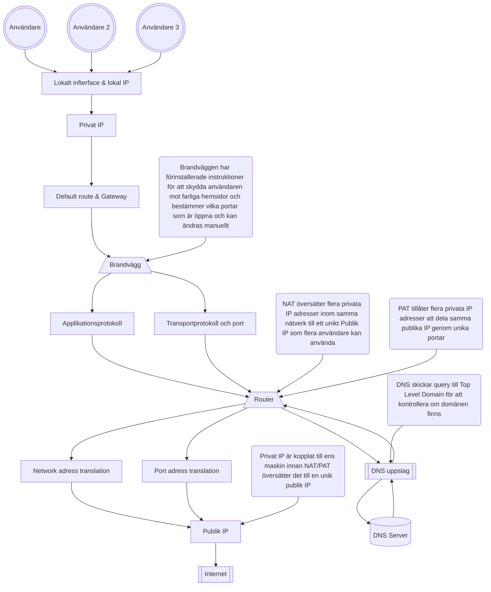
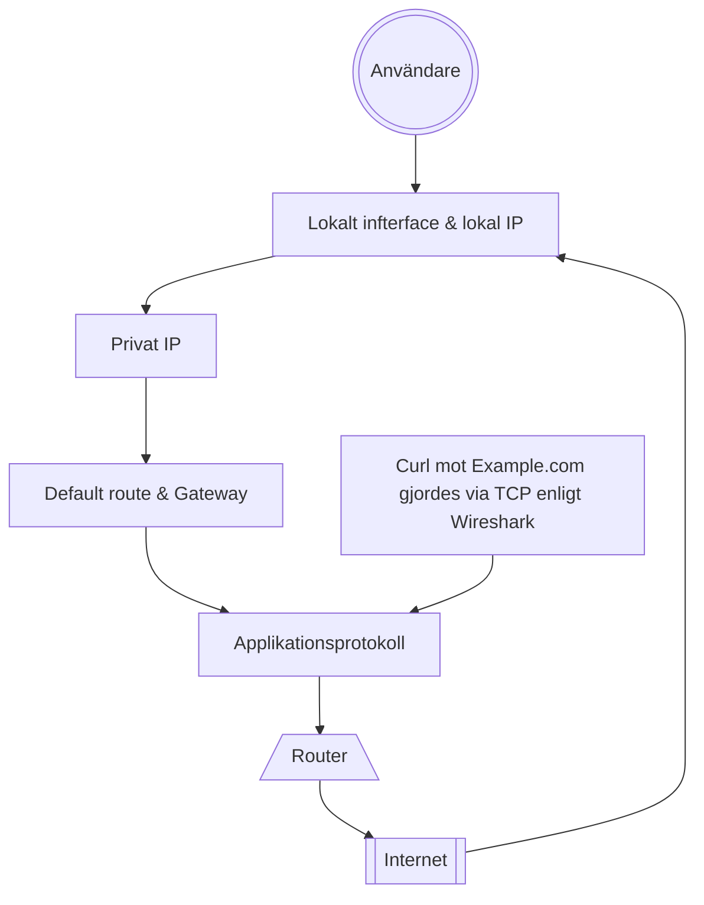

## SÄKERHETSRAMAR

### DU FÅR INTE

* Fånga andras trafik
* Portskanna eller använda brute force
* Publicera pcap
* Testa mål utanför godkänd miljö

### GÖR ISTÄLLET

* Använd egen miljö eller reservspår som trafikgenerator eller pcap filer som blev uppladdade "week38_packet_journey_basic.pcap" och "week38_packet_journey_advanced.pcap"
* Begränsa tid, interface och mål
* Sanera adresser och andra identifiers
* fråga läraren vid osäkerhet via Slack

Definition of Done
[X] Miljö, spår och metod är tydligt beskrivna.
[X] Fångsten är begränsad, tillåten och säker, eller reservspåret är motiverat.
[X] Paketets väg är beskriven med observation och förklaring åtskilda.
☐ DNS, ICMP, TCP, HTTP och TLS/HTTPS är analyserade eller saknad trafik är korrekt redovisad.
☐ Två flöden har analyserats på djupet.
☐ HTTP och TLS/HTTPS har jämförts.
☐ Brandvägg och hardening har kopplats till faktisk trafik.
☐ CIA-analysen bygger på konkreta observationer.
☐ Begränsningar och osäkerheter är synliga.
☐ Rapport och skärmbilder är sanerade.
☐ Rå pcap finns inte i GitHub utan uttryckligt tillstånd.
☐ AI-användning är redovisad.
☐ Canvas innehåller en fungerande direktlänk till rapporten.

| Område | Godkänt | Väl godkänt |
|---|---|---|
| Nätverksförståelse	| Förklarar grundläggande samband mellan adress, route, DNS, port och protokoll.	| Följer paketets väg konsekvent och skiljer observation från underbyggd teknisk förklaring. |
| Paketanalys	| Identifierar föreskrivna protokoll och visar relevant evidens.	| Analyserar flöden, ordning, metadata, avvikelser och alternativa förklaringar nyanserat. |
| Kryptering och säkerhet	 |Beskriver grundskillnaden mellan HTTP och TLS/HTTPS.	| Resonerar precist om synlig metadata, skyddad data, felsökningsvärde och konfidentialitetsrisk. |
| Brandvägg och hardening	| Kopplar trafik till regelprinciper och rimliga tjänster.	| Förklarar lager, tillstånd, default deny och minsta öppning med tydlig koppling till evidensen. |
| CIA och evidens	| Gör relevanta CIA-kopplingar och hanterar materialet säkert.	| Visar stark spårbarhet, identifierar begränsningar och formulerar proportionerliga rekommendationer. |
| Dokumentation	| Rapporten är begriplig, strukturerad och komplett.	| Rapporten är reproducerbar, analytisk och tydligt avgränsad. |

----------------------------------

## Miljö och Metod

Miljö: OCI
Interface: Windows & OCI Ubuntu 26.04
Fångst: OCI tcpdump med SCP överföring, genom att använda -i any i tcpdump får man en bredare fångst där man inte behöver vara väldigt specifik i vad man letar efter, perfekt för troubleshooting.

Fångsten på OCI stoppas efter 1500 paket, jag stoppade manuellt tidigare med ctrl + c. Koden var för denna fångst:
    sudo tcpdump -i any -s 0 -c 1500 -w inluppg.pcap

Jag tog inspiration från trafikgeneratorn och lade upp dessa i rad efter varandra medans tcpdump var igång:

    ping 8.8.8.8 | head -11
    nslookup example.com
    ping 127.0.0.1 | head -11
    curl http://www.example.com/
    curl https://www.example.com/

I grund och botten har jag tagit inspiration från trafikgeneratorn men jag har lagt in en server som jag hostar på 8080 som jag pingar till som en extra del i min fångst.

### Beskriv hur pcap och skärmbilder har hanterats och sanerats.

pcap eller skärmbilder kommer läggas in i evidence/screenshots/w38. Jag kommer att redigera screenshots och bilder som tas under analys som en del av saneringen men inget har lagts till än.

Struktur på repot och vart du hittar bilderna är nämnt ovan samt märkt i strukturen nedan.

│

├── docs

│ └── week3_secure_network_check.md

│

├── evidence

│ └── screenshots

│   └── w38 <-- 

│

│ └── README.md

│

│

├── README.md

└── ...

strukturen tagen är från Canvas: Oracle Cloud VM, Linux, hardening, recovery och cleanup 

### Förklara relevanta skillnader mot lärarens OCI-demonstration.

Den stora skillnaden är att jag kallar på olika funktioner utanför ett skript för att simulera tid mellan samt för att skapa en djupare förståelse hur wireshark fungerar.
Jag överför då pcap filen från min OCI miljö till min primära dator där jag kan analysera paketen som jag både har tagit emot och skickat.

---------------------------------------

## Paketets Väg

### Här nedan skapar jag ett flödesschema över min förståelse hur allt hänger ihop:

### Rita eller beskriv ett av flödena i din pcap från applikationen till destinationen.
* lokalt interface och lokal IP-adress
* DNS-uppslag
* default route och gateway
* privat respektive publik adress
* NAT/PAT som princip
* brandväggens möjliga beslutspunkt
* transportprotokoll och port
* applikationsprotokoll

Jag har valt ett flöde genom en curl mot HTTP example.com som jag tycker är väldigt intressant.

| Observation | Förklaring | Osäkerhet | Säkerhetsbetydelse / CIA |
|---|---|---|---|
|Curl till HTTP://www.example.com | Jag kan se att när jag skickade en curl mot addressen så svarar addressen och jag kan se information om hemsidan och dens uppbyggnad. Kort översikt: Ser 4 packet, En okrypterad HTTP request, Lyckad respons från servern, TCP sekvens och ACK nummer, tid mellan paketen, TTL + RTT samt att responsen från servern är genom text och HTML. | Då jag har inte jobbat i wireshark mycket har jag haft svårigheter att förstå eller analysera paket där information kan vara känslig, som visas i en sanerad screenshot från httpexample.png så har jag svårt att förstå om t.ex TSVAL eller TSecr håller någon särkild vikt inom sanering | Om man kollar utifrån ett säkerhetstänk så har jag sanerat denna fil samt strukit över information som IP addresser och vägen till destinationen. Detta kan både kopplas till integriteten där jag kollade om pcap filen blev ändrad under SCP överföringen genom att generera checksums för filen och kontrollerade hashen mot varandra och konfidentialitet där jag såg till att vissa portar var stängda och var inloggad via en SSH nycket. |

Här är en miniatyr av min förståelse av flödet:

### Fördjupning av protokoll
Identifiera flödet och ändpunkterna
Ordna relevanta paket i tidsföljd
Jämför protokoll, synlighet och resultat
Avgränsa vad fångsten kan visa
Vad skyddas av krypteringen?
Hur syns brandvägg och hardening indirekt?
Hur kopplas saniterad evidens till CIA?

* Konfidentialitet: Vad exponeras eller skyddas?
* Integritet: Vad kan ändras eller verifieras?
* Tillgänglighet: Når trafiken avsedd tjänst?
  
### CIA frågor
Konfidentialitet Vilken metadata är synlig? Vad är läsbart i HTTP? Vad skyddas av TLS? Kan pcap-filen i sig vara
känslig?
Integritet Hur vet du vilken fil som analyserats? Hur bidrar filnamn, hash, paketnummer och Git-historik till
spårbarhet?
Tillgänglighet Vilka tecken visar att DNS, route och transport fungerar? Vad kan timeout, reset eller uteblivet svar
betyda?

----------------------------------

* Evidensbeskrivning	evidence/README.md med pcap-källa, datum för analys, miljö och eventuell sanering

## Evidenskvalitet

Var samlades trafiken in?
Vilka filter eller avgränsningar användes?
Vad saknas/saknades vid fångsten?
Vilken osäkerhet ska anges? (förklara, var konkret)

### Vad ska jag anteckna
☐ Paketnummer eller annan tydlig hänvisning.
☐ Källa, destination och protokoll.
☐ Vilket lager eller vilken funktion observationen hör till.
☐ Vad observationen visar.
☐ Vad observationen inte räcker för att slå fast.
☐ Om uppgiften innehåller känslig metadata som behöver saneras

---------------------------------------

## fördjupad analys av två flöden

Identifiera flödet och ändpunkterna
Ordna relevanta paket i tidsföljd
Jämför protokoll, synlighet och resultat
Avgränsa vad fångsten kan visa
Vad skyddas av krypteringen?
Hur syns brandvägg och hardening indirekt?
Hur kopplas saniterad evidens till CIA?

* Konfidentialitet: Vad exponeras eller skyddas?
* Integritet: Vad kan ändras eller verifieras?
* Tillgänglighet: Når trafiken avsedd tjänst?
  
### CIA frågor
Konfidentialitet Vilken metadata är synlig? Vad är läsbart i HTTP? Vad skyddas av TLS? Kan pcap-filen i sig vara
känslig?
Integritet Hur vet du vilken fil som analyserats? Hur bidrar filnamn, hash, paketnummer och Git-historik till
spårbarhet?
Tillgänglighet Vilka tecken visar att DNS, route och transport fungerar? Vad kan timeout, reset eller uteblivet svar
betyda?

----------------------------------

## Evidenskvalitet

Var samlades trafiken in?
Vilka filter eller avgränsningar användes?
Vad saknas/saknades vid fångsten?
Vilken osäkerhet ska anges? (förklara, var konkret)

### Vad ska jag anteckna
☐ Paketnummer eller annan tydlig hänvisning.
☐ Källa, destination och protokoll.
☐ Vilket lager eller vilken funktion observationen hör till.
☐ Vad observationen visar.
☐ Vad observationen inte räcker för att slå fast.
☐ Om uppgiften innehåller känslig metadata som behöver saneras

## Fördjupa flöden

Kan verifiera och jämföra vissa protokoller mot varandra för att se skillnad:

DNS <-> ICMP
HTTP <-> TLS/HTTPS
Lyckad anslutning <-> Uteblivet svar
egen pcap med reservspår genom trafigeneratorn

----------------------------------

## Brandvägg info

* SS bevisar lokalt lyssande tjänster men inte ensam extern nåbarhet
* Brandväggsregler beskriver avsedd tillåtelse eller blockering
* PCAP visar observerad nätverkstrafik vid fångspunkt

----------------------------------
