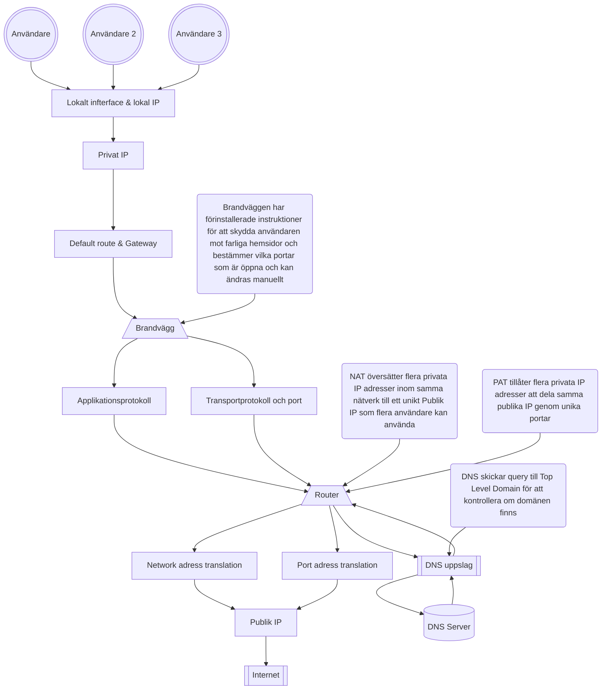

## Miljö och Metod

Miljö: OCI
Interface: Windows & OCI Ubuntu 26.04
Fångst: OCI tcpdump med SCP överföring, genom att använda -i any i tcp dumb får man en bredare fångst där man inte behöver vara väldigt specifik i vad man letar efter, perfekt för troubleshooting.

Fångsten på OCI stoppas efter 1500 paket, jag stoppade manuellt tidigare med ctrl + c. Koden var för denna fångst:
    sudo tcpdump -i any -s 0 -c 1500 -w inluppg.pcap

Jag tog inspiration från trafikgeneratorn och lade upp dessa i rad efter varandra medans tcpdump var igång:

    ping 8.8.8.8 | head -11
    nslookup example.com
    ping 127.0.0.1 | head -11
    curl -m 5 -sS -o /dev/null http://example.com
    curl -m 5 -sS -o /dev/null https://example.com

I grund och botten har jag tagit inspiration från trafikgeneratorn men jag har lagt in en server som jag hostar på 8080 som jag pingar till som en extra del i min fångst.

### Beskriv hur pcap och skärmbilder har hanterats och sanerats.

pcap eller skärmbilder kommer läggas in i evidence/screenshots/w38. Jag kommer att redigera screenshots och bilder som tas under analys som en del av saneringen men inget har lagts till än.

Struktur på repot och vart du hittar bilderna är nämnt ovan samt märkt i strukturen nedan.

│

├── docs

│ └── week3_secure_network_check.md

│

├── evidence

│ └── screenshots

│   └── w38 <-- 

│

│ └── README.md

│

│

├── README.md

└── ...

strukturen tagen är från Canvas: Oracle Cloud VM, Linux, hardening, recovery och cleanup 

### Förklara relevanta skillnader mot lärarens OCI-demonstration.

Den stora skillnaden är att jag kallar på olika funktioner utanför ett skript för att simulera tid mellan samt för att skapa en djupare förståelse hur wireshark fungerar.
Jag överför då pcap filen från min OCI miljö till min primära dator där jag kan analysera paketen som jag både har tagit emot och skickat.

---------------------------------------

## Paketets Väg

lokalt interface och lokal IP-adress: OCI, 127.0.0.1

| DNS Uppslag | Slutsats (stöd) | Osäkerhet | Säkerhetsbetydelse & CIA |
|---|---|---|---|
| DNS paket till example.com | vad syns (var konkret) | vad stöder observationen | vad kan inte avgöras |
| DNS paket till example.com | vad syns (var konkret) | vad stöder observationen | vad kan inte avgöras |
| DNS paket till example.com | vad syns (var konkret) | vad stöder observationen | vad kan inte avgöras |
| DNS paket till example.com | vad syns (var konkret) | vad stöder observationen | vad kan inte avgöras |

| Route & Gateway | Privat & Publik adress | Osäkerhet | Säkerhetsbetydelse / CIA |
|---|---|---|---|
| Default via 10.0.0.1 och 10.0.0.191| vad syns (var konkret) | vad stöder observationen | vad kan inte avgöras |

### Vad är NAT PAT?

• privat respektive publik adress
• NAT/PAT som princip
• brandväggens möjliga beslutspunkt
• transportprotokoll och port
• applikationsprotokoll

## Fördjupning av protokoll

Identifiera flödet och ändpunkterna
Ordna relevanta paket i tidsföljd
Jämför protokoll, synlighet och resultat
Avgränsa vad fångsten kan visa
Vad skyddas av krypteringen?
Hur syns brandvägg och hardening indirekt?
Hur kopplas saniterad evidens till CIA?

* Konfidentialitet: Vad exponeras eller skyddas?
* Integritet: Vad kan ändras eller verifieras?
* Tillgänglighet: Når trafiken avsedd tjänst?
  
### CIA frågor
Konfidentialitet Vilken metadata är synlig? Vad är läsbart i HTTP? Vad skyddas av TLS? Kan pcap-filen i sig vara
känslig?
Integritet Hur vet du vilken fil som analyserats? Hur bidrar filnamn, hash, paketnummer och Git-historik till
spårbarhet?
Tillgänglighet Vilka tecken visar att DNS, route och transport fungerar? Vad kan timeout, reset eller uteblivet svar
betyda?

----------------------------------

* Evidensbeskrivning	evidence/README.md med pcap-källa, datum för analys, miljö och eventuell sanering

## Evidenskvalitet

Var samlades trafiken in?
Vilka filter eller avgränsningar användes?
Vad saknas/saknades vid fångsten?
Vilken osäkerhet ska anges? (förklara, var konkret)

### Vad ska jag anteckna
☐ Paketnummer eller annan tydlig hänvisning.
☐ Källa, destination och protokoll.
☐ Vilket lager eller vilken funktion observationen hör till.
☐ Vad observationen visar.
☐ Vad observationen inte räcker för att slå fast.
☐ Om uppgiften innehåller känslig metadata som behöver saneras

Fyll i rapporten!

## WEEK 38 WIRESHARK

### FÖLJ -> FÅNGA -> FILTRERA -> ANALYSERA -> FÖRKLARA
### Du ska kunna:
* Följa ett paket
* Visa vad som syns i trafiken
* Förklara säkerhetsbetydelsen utan att överdriva
* Bevisa, vara konkret utan gissningar
* Anteckna osäkerheter

----------------------------------

## Rapport och evidens av Wireshark

| Observation (Konkret) | Slutsats (stöd) | Osäkerhet | Säkerhetsbetydelse / CIA |
|---|---|---|---|
|tex. HTTPS | vad syns (var konkret) | vad stöder observationen | vad kan inte avgöras |

----------------------------------
## Fördjupning av protokoll

Identifiera flödet och ändpunkterna
Ordna relevanta paket i tidsföljd
Jämför protokoll, synlighet och resultat
Avgränsa vad fångsten kan visa
Vad skyddas av krypteringen?
Hur syns brandvägg och hardening indirekt?
Hur kopplas saniterad evidens till CIA?

* Konfidentialitet: Vad exponeras eller skyddas?
* Integritet: Vad kan ändras eller verifieras?
* Tillgänglighet: Når trafiken avsedd tjänst?
  
### CIA frågor
Konfidentialitet Vilken metadata är synlig? Vad är läsbart i HTTP? Vad skyddas av TLS? Kan pcap-filen i sig vara
känslig?
Integritet Hur vet du vilken fil som analyserats? Hur bidrar filnamn, hash, paketnummer och Git-historik till
spårbarhet?
Tillgänglighet Vilka tecken visar att DNS, route och transport fungerar? Vad kan timeout, reset eller uteblivet svar
betyda?

----------------------------------

## Evidenskvalitet

Var samlades trafiken in?
Vilka filter eller avgränsningar användes?
Vad saknas/saknades vid fångsten?
Vilken osäkerhet ska anges? (förklara, var konkret)

### Vad ska jag anteckna
☐ Paketnummer eller annan tydlig hänvisning.
☐ Källa, destination och protokoll.
☐ Vilket lager eller vilken funktion observationen hör till.
☐ Vad observationen visar.
☐ Vad observationen inte räcker för att slå fast.
☐ Om uppgiften innehåller känslig metadata som behöver saneras

Fyll i rapporten!

----------------------------------

## Fördjupa flöden

Kan verifiera och jämföra vissa protokoller mot varandra för att se skillnad:

DNS <-> ICMP
HTTP <-> TLS/HTTPS
Lyckad anslutning <-> Uteblivet svar
egen pcap med reservspår genom trafigeneratorn

----------------------------------

## Brandvägg info

* SS bevisar lokalt lyssande tjänster men inte ensam extern nåbarhet
* Brandväggsregler beskriver avsedd tillåtelse eller blockering
* PCAP visar observerad nätverkstrafik vid fångspunkt

----------------------------------

## SÄKERHETSRAMAR

### DU FÅR INTE

* Fånga andras trafik
* Portskanna eller använda brute force
* Publicera pcap
* Testa mål utanför godkänd miljö

### GÖR ISTÄLLET

* Använd egen miljö eller reservspår som trafikgenerator eller pcap filer som blev uppladdade "week38_packet_journey_basic.pcap" och "week38_packet_journey_advanced.pcap"
* Begränsa tid, interface och mål
* Sanera adresser och andra identifiers
* fråga läraren vid osäkerhet via Slack

----------------------------------
