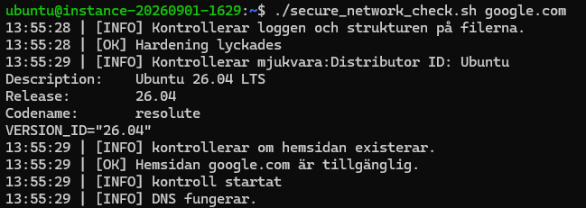
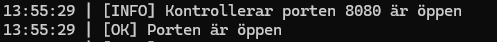
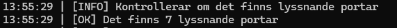
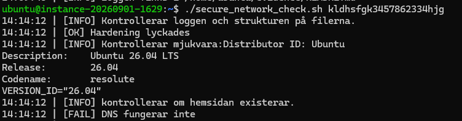
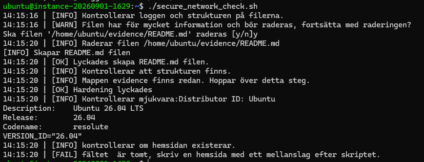
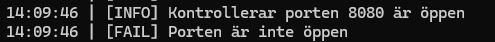
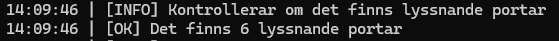

## Testing

Här kommer skärmdumpar samt reflektion ske vid vissa utfall från skriptet

## Tester som utförs på skriptet:

### Normalfall 1
Jag har gjort att man skriver en hemsida utanför skriptet utav säkerhetsskäl. I denna kontroll kommer jag använda mig utav google.com

 

Här kan man se att google.com svarar genom loggen [INFO] DNS Fungerar. Förbättring här kunde vara att göra ett OK istället för INFO.

* Det förväntade resultatet: Jag förväntade mig att genom att skriva ./secure_network_check.sh google.com skulle starta skriptet och ha google.com som variabeln som sparas för sökning i skriptet.
  
* faktiska resultatet: Utfärdades som planerat
* slutsats: att skapa target=$1 som variabel som kallas utanför skriptet fungerade utmärkt då det kändes lite osäkert i början medans jag byggde upp grunden. Som slutsats fungerade som planerat.

### Normalfall 2
I testet för lokala tjänster har jag gjort att om skriptet antingen hittar tjänster som lyssnar eller att specifikt port 8080 är uppe får jag en logg på att den hittar tjänster och räknar upp hur många samt om en lokal server är öppen på port 8080.

Här visar mitt skript tydligt att port 8080 är öppen:

Här visar den hur många lyssnande portar som finns aktiva vid tillfället: 

* Det förväntade resultatet: Jag förväntade att den skulle kunna hitta en specifik tråd där jag använde mig av grep funktionen.
* faktiska resultatet: Den hittade porten samt hur många lyssnare som finns genom grep och wc -l som underlättade enormt.
* slutsats: Att använda grep och wc -l är bra verktyp för att extrahera hård data utan att skapa potentiell exponering av känslig information. 

----------------------------------------------------------------

### Felfall 1
Då jag har skapat ett skript som kontrollerar hemsidan utanför skriptet skapar detta en enkel kontroll om hemsidan finns eller inte, samt om skriptet körs utan att skriva något efter du exekverar skriptet:

Ogiltig hemsida:

Här kan man se på ett enkelt sätt att DNS funktionen inte fungerar och visar då att hemsidan man skrev är onåbar.

Lämnar fältet tomt:

Jag har också gjort så att om adressfältet är tomt så stoppas skriptet för att se till att man antingen skriver rätt adress man vill kontrollera eller om man helt enkelt glömde att skriva in det till att börja med. 

* Det förväntade resultatet: Jag hade hoppats att den gav mig något form av felmeddelande som t.ex att den inte hittade DNS servern
* faktiska resultatet: Skriptet hittade inte hemsidan som nämnt.
* slutsats: Jag testade aldrig att skriva fel output som en kombination av bokstäver och nummer, detta är bra då den svarar ändast på existerande hemsidor och skyddar sig mot injecering eller strings som kan utföra skada mot koden.
  
* notering: jag skapade också en extra funktion som stoppade skriptet om man lämnade fältet tomt och fungerade utan komplikationer.

### Felfall 2

Här visar mitt skript tydligt att port 8080 inte är öppen:

Här behövde jag stänga ner servern för att kontrollera att skriptet känner igen att porten 8080 är nere ooch fick då ett felmeddelande samt att detta lägger till i summeringen hur många fel det uppstår under skriptets process.

Här visar mitt skript tydligt att port 8080 är stängd genom antalet LISTEN som den kan hitta genom ss -tuln:

Med denna räkning från felfallet i jämförelse med när porten 8080 var öppen i normalfallet så kan man se att porten faktiskt är stängd.

* Det förväntade resultatet: Då grep fungerade i normal fallet så förväntade jag mig att denna funktion också kunnde skriva en felkod då jag gjorde en "else" i if satsen.
* faktiska resultatet: Den skrev ut det som var planerat och loggade det i filen jag ville.
* slutsats: Funktionen fungerade som planerat.
  
----------------------------------------------------------------

## Koppling till vecka 36

* Hardening: jämför lyssnande portar och tjänster med vad du förväntar dig efter genomförd hardening. Motivera
minst en tjänst som behöver finnas kvar.

Reflektion: Efter att jag har kört igenom mitt skript och kontrollerat att min HTTP server på 8080 är nere kan jag se att portarna 53, 22 och 111 är öppna. Jag har gjort lite research på howtouselinux.com som beskriver port 111 som är någon form av portmap.
Jag trodde först att det var en port jag möjligtvis kunde stänga men ser ut som att det är en tjänst som bör vara öppen ifall jag vill skicka filer mellan system. Dessa tre portar verkar vara väldigt viktiga för drift, specifikt port 22 som är för ssh. Port 53 är viktig då denna hanterar DNS så ingen tvekan om att denna behövs.

* Backup och recovery: förklara vilka två nätverkskontroller i ditt verktyg som du skulle köra först efter en
återställning och vad de verifierar. Ingen ny restore krävs.

Reflektion: Om jag kör mitt program kommer alltid kontrollen om mapp strukturen finns eller inte samt om den har ändrade rättigheter. Detta skapar en bra grund för att skriptet kan fortsätta samt att den kontrollerar att vissa portar är aktiva, eller om den är kopplad till internet kan vara nog information för att kunna börja med felsökningar.