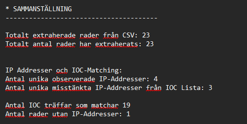
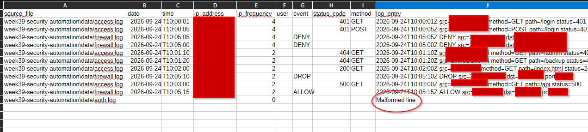
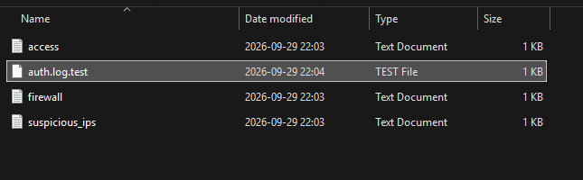
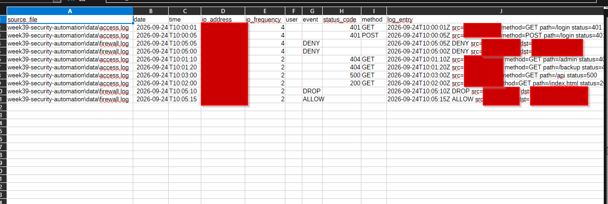
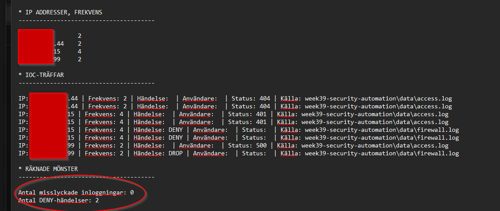

##  Metod
--------------------------------------------

Metoden för hantering av data har valts utav lärande ändamål för att skapa en bredare förståelse hur man kan skapa en databas och sedan hur hanteringen sker därefter.

Jag har valt att använda mig utav Pandas för detta moment, något jag inte vissta fanns innan jag började med projektet.
Hur programmet jobbar är följande:

Alla loggar analyseras och filtreras för att sedan bli lagt till i databasen som heter [security_report.csv](../output/security_report.csv)
när allt är på sin plats i databasen kan man sedan metodiskt kalla på information från specifika kolumner.
Då programmet tar alla logga som slutar på .log samt att data kan extraheras genom kommandon från både Jupyter men också inuti programmet så kan framtidsförsäkra programmet på ett enkelt sätt.

Om jupyter låter intressant behöver man starta upp programmet med:

    import pandas as pd
    import pathlib as path

    main_path = path.Path.cwd() / "week39-security-automation" / "output"
    df = pd.read_csv(path.Path.cwd().parent / "output" / "security_report.csv")

Sedan kan man använda sig av:

    df #Visar hela CSV databasen
    df.columns #visar alla kolumner med namn
    df.head(10) #visar 10 första i databasen
    df.tail(10) #visar 10 sista i databasen

Fler användbara kommandon kan hittas på som ett exempel [^2] 

Resurser jag har använt mig mycket av var på youtube via dessa externa länkar: [^3] [^4]

## 01. ANALYS
--------------------------------------------
| DEL | FRÅGA ATT BESVARA |
|---|---|
| Rådata |	Vilka filer och loggrader användes? |
| Observation | Vad räknade eller matchade programmet konkret? |
| Slutsats | Vilken begränsad slutsats stöds av observationen? |
| Osäkerhet | Vad kan data och program inte fastställa? |
| Alternativ förklaring	| Vilka andra rimliga orsaker kan ge samma mönster? |
| Säkerhetsbetydelse | Varför är resultatet relevant för fortsatt analys eller prioritering? |

## 02. Rådata: Vilka filer och loggrader användes? 

Rådatan som analyseras är "Dataset B: Advanced" som innehåller en access.log, aut.log och firewall.log. Genom dessa filer har jag lyckats att skapa en grund där programmet läser samtliga loggrader från filer som blir placerade i ./data.  Programmet har blivit framtidssäkrad genom en filtrering utav Regex kod som läser in och filtrerar inkommande data och sedan via denna process placerar rätt data i rätt kolumn. 

## 03. Testning och verifiering

### 03.1 Tre dokumenterade testfall:
--------------------------------------------

Första testfallet var ganska rak på sak när det kommer till malformed line som fångades upp i uppgiften. När kag körde programmet så såg jag direkt att denna lästes in i databasen. Jag gav inte det så mycket eftertanke tils jag började struktuera rapporten och märkte att det kan vara ganska enkelt att få ut den datan oavsikligt. Genom att lägga till extra åtgärder i koden som ser till att om den hittar specifika delar av strängen, i detta fall Mal/mal & Line/line så kommer jag få ett felmeddelande längre ner där den hittade denna strängen och avsluta återkallningen till rapporten.

    def valid_lines(line):
        #Kontrollerar om vissa linjer finns som till exempel malformed och lines dycker upp. Detta var en av testfallen jag skapade för att se till att tomma linjer eller just en malformed line inte dyker upp i csv databasen 
        line = line.strip()
        if not line:
            return False
    
        if line == "Mal":
            return False
        if line == "mal":
            return False
        if line == "Line":
            return False
        if line == "line":
            return False
    
    return True

Personligen efter att ha jobbat mycket med if funktioner så har jag börjat att tycka om att använda try: hellre för specifika fel och statuskoder som kan vara svåra att fånga upp med en enkel if även om man kan göra samma sak.

### 03.2 Identifiera ip mot IOC
--------------------------------------------

Då jag jobbar med kolumner kan jag skapa bättre struktur genom större projekt och filer och skapar en säkrare grund än att direkt räkna från ett text dokument.
Momentet att försöka matcha IP addresserna mot IOC var nog en av momenten jag hade svårast att tackla då jag behövde använda mig av olika metoder som i slutändan inte fungerade som tänkt.

#### 03.2.a) Normalfall
--------------------------------------------

Genom att kunna kalla på "ip_address" kolumnen i databanken genom att skapa en tom kolumn utan data så kan man använda report_data som en tunnel mellan databasen och rapporten. Detta gjorde det möjligt att kunna bygga på programmets utdata flöde med andra variabler som följer efter rad 436.

    #sample kod tagen från rad 387
    report_data["IOC_match"] = (
        report_data["ip_address"]
        .isin(suspicious_ips)
    )

    #sample kod tagen från rad 429 - 436.
    matched_data = report_data[
        report_data["IOC_match"] == True
    ].copy()
    
    matched_data = matched_data.sort_values(
        by=["ip_address", "source_file"],
        ascending=True
    )

Denna inspiration hittades på Pandas hemsida under pandas.dataframe.isin() [^1] 

Genom matchningen kunde jag då få utdata som ser ut såhär i rapporten:

#### 03.2.b) Felfall
--------------------------------------------

En sample kod som inte fungerade på grund av att summeringen genom Diff import fungerade inte som jag hade tänkt. Detta var kommenterat som en legacy import i koden. Då arrays är en väg att kunna skapa counters för var IP träff så gör den det för alla träffar av IP vilket inte är vad jag är ute efter. Om legacy koden kördes så fick man över 20 träffar i while loopen istället för att ge en summa som .sum() eller value_counter() kan enklare klara av:

    with open(log_file, "r", encoding="utf-8") as f1:
        
            file1_lines = [
                    line for line in f1
                    if line
                    ]

    with open(Security_ioc, "r", encoding="utf-8") as f2:
    
        file2_lines = [
                line for line in f2
                if line
                ]
        
    print(f"Skapar en fullständig rapport genom att matcha {f2} mot {f1}")
    
    susp_ips = {line.strip() for line in file1_lines if line.strip()}
    diff = list(differ.compare(file1_lines, file2_lines))
    
    print(f"Matchningar som kommer att jämföras mot: {susp_ips} som finns noterat i {f1}")
    
    
    with open(report, "w", encoding="utf-8") as f:
        f.write("\n".join(report_lines))

Tanken var att matcha logfilerna mot ioc dokumentet först för att kunna skapa snabba matchningar men då jag använder en databas behövdes andra åtgärder där jag behövde kalla ut datan genom kolumner. När jag hade denna koden och försökte köra det så blev resultatet av testen att jag inte fick någon data överfört all från databasen även om IP addresserna hittades och räknades ut.

(Notering: while loopen var inte medtagen av misstag och kan inte hitta koden som ändrades. Sample koden ovan var huvud koden för att kunna skapa matching mellan fil 1 och fil 2 genom diff variabeln.)

### 03.3 Hitta mönster genom matching av IOC och IP addresser
--------------------------------------------

Att hitta mönster genom att kunna extrahera data som beskrivet i 02.2.a) Normalfall så blir datan konsis och inget man kan alternera på efter att databasen har extraherat allt från data/. Att ha skapat ett filtrerings system som kontrollerar IOC listan oavsett hur stor den är visar flexibiliteten av programmet även om kodningen i sig är ganska hårdkodad. 

### 03.4 Jämför programmets resultat med ett manuellt räknat kontrollvärde
--------------------------------------------

Jag förstod inte helt vad menades med "Jämför programmets resultat med ett manuellt räknat kontrollvärde." men det jag testade var att både att ändra vad för sorts data som fanns i Auth.log för att se att relevansen av indexeringen kunde hantera datan.

Första delen var att testa att bara malformed line fanns i auth.log och då hittade regex denna linje och importerade den, det jag kan göra i framtiden är att skapa en regex för att filtrera ut linjer som inte passar in i data extraheringen.

Därefter gjorde jag att auth.log var döpt till auth.log.test som visat på bilden nedan:

Det som jag tänkte skulle hända var att den skulle kunna hitta filen då det fanns en .log i filens namn men detta gav mig ett tomt resultat. 
Jag tänkte att koden nedan skulle kunna hitta det oavsett:

    log_files = [
        file for file in folder.rglob("*.log")
        if file.is_file()
        ]

När namnet var auth.log.test kunde inte datan extraheras och det syntes både i databasen men också i slut rapporten:

Exempel 1:

 

Exempel 2:

### 03.5 Dokumentera  hoppade rader i rapport eller analys
--------------------------------------------

Då all data samlas i databasen och genom filtrering kommer inga tomma rader med i utvärderingen. Finns tyvärr inget mer att tillägga i detta avsnitt.

## 04. Observation: Vad räknade eller matchade programmet konkret?

Programmet är skapat för att kunna analysera indatan på ett effektivt sätt genom databashantering. Datan blir därefter matchad mot IOC filen för att kunna hitta mönster gentemot användare, IP-addresser och utvalda events som misslyckade inloggnings försök.

Programmet räknar också frekvensen utav unika IP-addresser och sedan räknar ut hår många gånger den unika addressen uppstår. Efter uträkning skapar den en lättviktig analys på om man behöver undersöka genom hög risk eller resterande bli medel risk där man inte behöver skapa någon action för tillfället.

### 04.1 Sammanställning av data
--------------------------------------------

Under min research hittade jag att pd.concat kan samla all information genom att kombinera information från loggfilerna till array som jag har döpt till dataframes, dataframes som jag förstår är standard från Pandas. Denna samlar då all information tills jag kallar på den igenom pd.concat i min "write_report()" funktion via "pd.concat(dataframes, ignore_index=True)"
    pd.concat(dataframes, ignore_index=True) #ignore index ignorerar att skapa ett index sålänge tills jag skapar databasen senare.

### 04.2 Regex filter
--------------------------------------------

Ett tag hade jag store problem med Regex filter och det var mycket trial and error och mycket googlande för att se till att databasen kände igen t.ex datum ordentligt.

    format = (
        r"(?P<date>\d{4}-\d{2}-\d{2})\s+" #YYYY-MM-DD
        r"T"
        r"(?P<time>\d{2}:\d{2}:\d{2}Z)\s+" #letar efter formatet HH:MM:SS
        r"src=(?P<ip_adress>\S+)\s+" #Filtrerar och letar efter src=
        r"user=(?P<user>\S+)\s+" #filtrerar efter user= 
        r"(?P<event>DENY|DROP|ALLOW|FAILED|status|method)" #letar efter specifika mönster som nämnt i regex för kolumnen event.
    )

    csv_formatting = log_files["log_entry"].str.extract( #Testar pandas.Series.str.extract kommando som jag hittade på pandas hemsida
        format,
        expand=True
        ) 

    csv_formatting["source_file"] = log_files["source_file"].values
    return csv_formatting

### 04.3 Regex filter application
--------------------------------------------

Denna regex blev sedan ersat med filtret som börjar på rad 138

Genom att skapa en filtrerings funktion var något som inte direkt fungerade i min filtrering. jag förstod därefter att jag tar bort all annan information som inte passar innanför dessa ramar och något jag kommer ta bort från min kod men är lärorikt att ta med sig i framtiden.

    log_entry = log_files["log_entry"] # här skapar jag en series som finns med i pandas som samlar all data från förr till ett 1 dimensionellt array som samlar all data tills jag kallar på dem längre ner.

    #skapar nu en mini funktion som läser av om någon linje får träff på mitt regex filter ovan
    date_match = log_entry.str.contains(
        date_time,
        regex=True,
        na=False  
    )
    ip_match = log_entry.str.contains(
        ip_pattern,
        regex=True,
        na=False  
    )
    users_match = log_entry.str.contains(
        users,
        regex=True,
        na=False  
    )
    events_match = log_entry.str.contains(
        events,
        regex=True,
        na=False  
    )
    
    combined_filter = ( #kombinerar dessa för att sedan kunna använda mig av pd.concat igen för att samla allt i min dataframe []
        date_match 
        & ip_match 
        & users_match 
        & events_match
    )

### 04.4 Try or If
--------------------------------------------

Try: ger bättre exception stoppar och errors än min föregående kod.

Legacy koden som jag bytte ut för att säkerställa att detta moment får konkreta felmeddelanden om saker går snett var viktigt för mig då detta moment specikt letar efter filer, utan filer så fungerar inte skriptet och vill då ha try och exception, denna gången använde jag exception error as error för att kunna skriva ut ett print. Här kunde man använda sig av "Except OSError" men error as error är ett bra generellt kommando.

Denna kod blev utbytt och förnyad och startar nu på rad 79.

def load_indicators(folder): #berättar vart filen finns  

    print("Kontrollerar filer i /data finns för uppgiften")
    folder = Path(folder)
    dataframes = []    
    
    log_files = [
        file for file in folder.rglob("*")
        if file.is_file()
        ]
    
    for file in log_files:
        try:
            with file.open("r", encoding="utf-8") as f:
                file_lines = 0
                
                for line in f:
                    line = line.strip()
                    
                    if line:
                        dataframes.append({
                            "log_entry": line,
                            "source_file": str(file)            
                            })
                        file_lines += 1
                print(f"Laddade filerna {file}: Hittade {file_lines} linjer av data")
                        
        except Exception as error:
            print(f"Kunde inte läsa {file}: {error}") 
        
    return pd.DataFrame(dataframes)

### 04.5 Addition är inte alltid bra
--------------------------------------------

Försökte att skapa regler för när panda hittade strängarna som börjar på t.ex "admin" detta var något som inte helt fungerade och som jag förstår skriver över alla andra poäng som jag ville lägga tillsammans och bara tar den senaste och skriver ut

    df["suspicious_activity"] = np.where(df["user"]=="admin", 0, 2)
    df["suspicious_activity"] = np.where(df["user"]=="root", 0, 3)
    df["suspicious_activity"] = np.where(df["status_code"]=="401", 0, 1)
    df["suspicious_activity"] = np.where(df["event"]=="DENY", 0, 1) 
    df["suspicious_activity"] = np.where(df["event"]=="Failed Login", 0, 1)
Denna kod var ganska klumpig och såg till att ändra detta till .sum() istället som samlar data i funktionen, detta blev ändrat på rad 262 där jag också testar olika indenterings mönster.

Ett annat försök var genom att använda mig av pd.loc så kan jag lättare lokalisera och skapa ett poängsystem av det jag vill ha som t.ex "admin" genom 

    df.loc[df["user"].eq("admin"), "suspcious_activity"] += 1
    #df är min dataframe
    #.loc är locate
    #["user"] är min kolumn
    #.eq är equals, samma som om jag skulle skriva =
   #Om .loc hittar "admin" i strängen så lägger den till en counter till suspicious activity kolumnen

Detta fungerar på samma logic som övningen vi gjorde i måndagen den 21:a
    failed_count = 0
    if "Failed login" in line:
            failed_count += 1

Denna logik fungerade tyvärr inte i längden och ny kod blev ändrad på rad 263

### 04.6 Filstruktur, räkning och observation
--------------------------------------------

Då jag jobbar med kolumner kan jag skapa bättre struktur genom större projekt och filer som skapar en säkrare grund än att direkt räkna från ett text dokument.
lösningen nedan fungerade inte på grund av att summeringen genom Diff import fungerade inte som jag hade tänkt, då arrays är en väg att kunna skapa counters för var IP träff så gör den det för alla träffar av IP vilket inte är vad jag är ute efter.

    with open(log_file, "r", encoding="utf-8") as f1:
        
            file1_lines = [
                    line for line in f1
                    if line
                    ]

    with open(Security_ioc, "r", encoding="utf-8") as f2:
    
        file2_lines = [
                line for line in f2
                if line
                ]
        
    print(f"Skapar en fullständig rapport genom att matcha {f2} mot {f1}")
    
    susp_ips = {line.strip() for line in file1_lines if line.strip()}
    diff = list(differ.compare(file1_lines, file2_lines))
    
    print(f"Matchningar som kommer att jämföras mot: {susp_ips} som finns noterat i {f1}")
    
    
    with open(report, "w", encoding="utf-8") as f:
        f.write("\n".join(report_lines))

## 05. Slutsats: Vilken begränsad slutsats stöds av observationen?

Observationen skapar en helhetsbild av loggarna som datan har samlats från, dessa blir då extraherade och blir rapporterade i [security_report.txt](../output/security_report.txt). 

Del av resultatet som skrivs ut för att se till att man inte skapar misstankar mot användare eller IP-addresser bara för att den dyker upp oftare än vanligt och oftast har en naturlig förklaring till varför personen har agerat som den har gjort under tiden själva fångsten ägde rum.

En snutt som jag också nämner i rapporten som är här nedan:

    "IOC-träffar visar att observerade IP-addresser förekommer i IOC Listan"
    "Detta betyder ej att personen är misstänkt."
    "Behöver bygga större case och evidens mot användare innan utredning startar."

    "Att användare eller IP förekommer i IOC-listan bevisar inte att en attack har ägt rum."
    "IP-addresser kan vara utdelade, förfalskade genom spoofing eller återanvända"

    "Analysen har byggs upp genom data extrahering, textmatching och regex för att säkerställa faktuell data."
    "Fält som inte följer med eller saknas helt följer inte förväntat format och kommer därför saknas i resultatet"

Då det är viktigt att poängtera att datan inte är fastslådd och att detta bara stöde indikator listan men att inget är färdigställt bara för att datan som sammanställ skrivs in i en rapport.

## 06. Osäkerhet: Vad kan data och program inte fastställa?

Även om observationen skapar en helhetsbild av fångsten så är den inte avgörande data. Detta i sig kan skapa osäkerhet genom att programmet kan oundvikligt indikera att en person är misstänkt för en attack vilket jag såg till att detta blev skrivet i rapporten som påminnelse. 

Programmet i fråga kan inte återskapa, fånga en specifik incident eller en attack som till exempel Wireshark kan, detta program analyserar data från fångst genom tredje parts applikationer som skapar loggarna 

## 07. Alternativ förklaring: Vilka andra rimliga orsaker kan ge samma mönster? 

Om man tänker innanför rimliga ramar har jag nämnt att det nödvändigtvis inte behöver vara samma person men att IP-addressen kanske har återanvänds. Personen har helt enkelt glömt sitt lösenord och testar olika lösenord som användaren kan tänkas ha använt vid registrering. När det kommer till att bli nekad genom en firewall kan det absolut skapa en viss misstanke då till exempel 401 som programmet samlar vid kompilering kan skapa indikationer på att någon som inte har rättigheter försöker att gära vissa moment som behöver elevering. Detta i sig behöver inte vara en indikation på angrepp men kan helt enkelt vara att användaren försöker gå in på en hemsida som brandväggen har manuellt blivit tillsagd att man inte ska få åtkomst till. 

## 08. Säkerhetsbetydelse: Varför är resultatet relevant för fortsatt analys eller prioritering?

Datan som analyseras visar och sammanställer rå data. Datan i sig kan vara relevant vid specifik analys om fångsten var bred eller om man behöver hitta mönster som mänskliga ögat möjligtvis kan missa. Genom att skapa en nyare version av programmet med möjligtvis en GUI så kan man lättare anpassa vad man söker efter vilket skapar användarvänlighet och flexibilitet.

--------------------------------------------
 ## EXTERNA LÄNKAR

[^1]: https://pandas.pydata.org/pandas-docs/stable/reference/api/pandas.DataFrame.isin.html#pandas.DataFrame.isin
[^2]: https://ordinarycoders.com/blog/article/25-python-commands-jupyter-notebook
[^3]: https://www.youtube.com/watch?v=EXIgjIBu4EU
[^4]: https://www.youtube.com/watch?v=2uvysYbKdjM